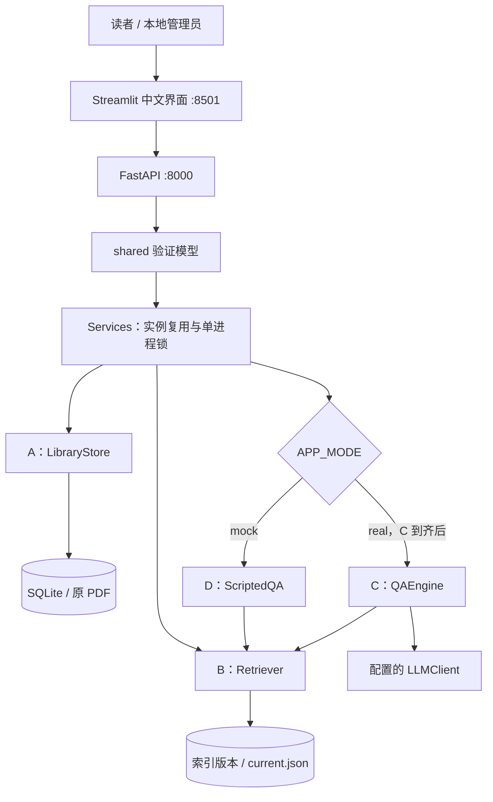
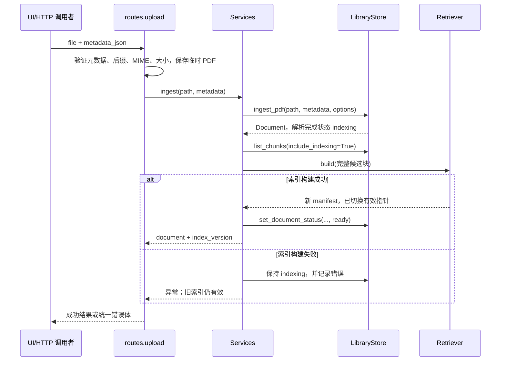

# 数字图书馆项目：结果、实现与搭建说明

> 2026-10-18 更新：当前已合入 A/B/C/D 全部实现。本文下方保留 2026-10-16 的函数说明与历史记录，不作为当前完成情况结论。当前运行步骤以根 README.md 为准，最新核验见 [部署更新与需求核验](../evaluation/reports/update_20261018/requirements_review.md)，C 已接入、候选汇总已补齐。附录的 122 项是历史版本范围，未涵盖后来新增的 C 和联调脚本。

> 文档日期：2026-10-16；项目包版本：0.1.0；共同接口契约：1.0。本文依据当前本地源码、测试 XML、启动记录和评估记录编写，涵盖 D 组开发及用户提供的 A/B 参考实现。
>
> 当前可运行链路：**A 的真实 PDF 解析与 SQLite 存储 → B 的真实检索和索引管理 → fake embedding → D 的脚本问答 → 中文界面与原文查看**。C 组尚未提供；真实模型问答与正式总体实验尚未完成。工程测试通过不等于真实问答质量达标。

## 阅读导航

- 想知道交付了什么：第 1～3 节。
- 想从零运行：第 4～6 节。
- 想了解请求怎样经过系统：第 7～9 节。
- 想运行实验、交接 C 或排查问题：第 10～13 节。
- 想逐个查看函数：附录 A，覆盖当前应用源码与 Python 业务脚本中的 **122 个具名函数、方法和校验器**，附真实签名、源码行号、输入、返回和副作用。测试函数不纳入这 122 项。

## 1. 项目要解决什么问题

项目面向一个有明确范围的 PDF 专题馆藏。读者可以按关键词或日常语言查找资料，按年份、主题缩小范围，并在问答结果中打开支持结论的原文和 PDF 文件。

完整目标流程是：上传具有使用说明的 PDF → 提取并规范页面文本 → 按页切成可定位片段 → 建立关键词/向量索引 → 检索相关片段 → C 生成有证据引用的结论、追问或证据不足提示 → D 展示并提供原文件入口。

第一版定位为本地可信课堂应用：FastAPI 后端、Streamlit 界面、SQLite、小规模馆藏、一个后端进程。当前没有公网部署、账号权限系统、OCR、复杂表格理解和 PDF 原页高亮。

## 2. 当前结果与完成范围

### 2.1 各组边界

| 组别 | 负责内容 | 本地现状 | 本次 D 的处理 |
|---|---|---|---|
| A | PDF、元数据、页面、Chunk、SQLite、原文件定位 | 用户提供的 A 源码已放入本地工程 | 原样接入；35 个归属文件字节比对一致 |
| B | BM25、向量、RRF 混合检索、索引保存和重载 | 用户提供的 B 源码已放入本地工程 | 原样接入；26 个归属文件字节比对一致 |
| C | 查询理解、澄清、证据选择、真实 LLM、引用生成与核验 | 尚未提供 | 保留装配入口；mock 时使用明确标识的 D 脚本替身 |
| D | 工程打包、统一配置、模型验证、API、界面、脚本、集成测试、总体评估 | 已实现并本地验证 | 见本文及 handoff/D 的原始记录 |

本次没有创建 Git 提交、推送、PR 或部署，没有调用真实嵌入服务或生成模型。A/B 附件中的历史 arXiv 记录属于各组既有结果，不是 D 本次重新完成的总体实验。

### 2.2 功能交付

| 功能 | 已实现的行为 | 当前验证边界 |
|---|---|---|
| 工程和配置 | src 包布局、固定直接依赖、.env 配置、运行数据分目录 | Windows Python 3.12.14 已验证，3.11 未实测 |
| 上传 | PDF 类型/大小/元数据校验，临时文件清理，A 入库后由 B 建索引 | 合成 PDF 和错误样例已测 |
| 馆藏 | ready 公开列表、年份/主题过滤、全部状态管理视图 | 未开展本轮真实馆藏人工核查 |
| 检索 | keyword/vector/hybrid、片段结果、文献聚合、版本一致性检查 | 算法用 B 真代码，向量用 fake，不能说明语义质量 |
| 问答展示 | 系统理解、结论、引用、相关文献、限制、错误、澄清与证据不足 | 当前为 D 的脚本问答，真实 C 未接入 |
| 证据 | evidence_id 编号、引用展开、原文卡片、PDF 页链接 | 引文与页号映射已自动验证；实际浏览器页跳转未人工验收 |
| 状态协调 | 单进程互斥、构建成功后 ready、失败保留旧索引及新文献可重试状态 | 故障注入和重启检查通过 |
| 反馈 | useful/not_useful 与评论写入本地 JSONL | 不包含账号或在线反馈平台 |
| 评估 | 候选汇总、校验、逐题记录、环境记录、分集合指标、人工表格 | 45 个未复核候选完成 mock 工具运行；真实实验拒绝执行 |

### 2.3 已验证结果

- 全量测试：**149 passed，2 warnings，18.41 秒**。其中 A/B 原有 107 项、D 新增 42 项；以 test_results.xml 为准。
- 后端和 UI 实际启动：8000、8501 健康检查均为 HTTP 200；模拟问答及原 PDF 返回均为 200；核验后服务已停止。
- 演示数据：2 篇合成资料、3 个片段，字符模式最大 1200、重叠 150；fake-sha256-v1，16 维。
- 候选问题：A/B/D 各 15，共 45；C 的 15 题缺失。候选划分 dev 36、test 9，尚不是冻结后的正式题集。
- mock 工具运行错误数为 0；真实质量指标和人工指标留空。真实评估尝试返回退出码 2，原因是未复核题 A001 被拒绝，不是模型实验成绩。

两条测试警告是 Starlette 的 httpx 测试客户端弃用提示，以及重复 PDF 保留原元数据的预期提示。曾发现 PyArrow 26 与 B 固定 NumPy 1.26.4 的二进制不兼容，已经锁定 PyArrow 19.0.1、pandas 2.2.3 并全量复测通过。

### 2.4 尚未完成的验收

真实 C 组接入、真实 embedding/LLM 调用与质量评估、全组约 60 题的交叉复核和冻结、真实馆藏人工检查、课堂浏览器 PDF 页跳转、可选 PDF 高亮。后续联调时应逐项补验，不能把 mock 的固定状态或耗时当真实效果。

## 3. 架构、目录和依赖

### 3.1 系统结构



UI 通过 HTTP 访问后端，不直接打开 SQLite，不加载 embedding 或问答引擎。A 不调用 B；B 不处理 HTTP；C 的接口由 D 注入。D 负责流程编排和边界校验，没有重新实现 A 的解析或 B 的检索算法。

### 3.2 目录用途

下表中的路径是相对于包含 pyproject.toml 的项目根目录的代码标识；本地源码绝对路径见附录链接。

```text
lib_management/
├─ pyproject.toml                 项目元数据、依赖、包资源、pytest 配置
├─ .env.example                  可复制的无密钥配置样例
├─ src/dlrag/
│  ├─ shared/config.py           Settings 统一配置
│  ├─ shared/models.py           请求、响应和跨字段验证
│  ├─ api/main.py                FastAPI 工厂及异常处理
│  ├─ api/routes.py              HTTP 路由
│  ├─ api/services.py            A/B/C 装配及流程协调
│  ├─ api/mock_qa.py             D 的问答测试替身
│  ├─ ui/app.py                  中文三页界面
│  ├─ ui/client.py               HTTP 客户端与引用/澄清辅助函数
│  ├─ ingestion/                用户提供的 A 实现，含 schema.sql
│  └─ retrieval/                用户提供的 B 实现
├─ scripts/seed_demo.py          合成 PDF 与现有库重建入口
├─ scripts/run_evaluation.py     D 总体评估入口
├─ scripts/start_api.ps1         Windows 后端启动辅助
├─ scripts/start_ui.ps1          Windows UI 启动辅助
├─ tests/integration/            D 的集成与界面测试
├─ tests/fixtures/               明确标记的合成文本
├─ tests/ingestion/              A 原有测试
├─ tests/retrieval/              B 原有测试
├─ evaluation/dataset/           候选题与标注指南
├─ evaluation/reports/           总体报告及本地运行输出
├─ handoff/A/、handoff/B/         附件原交接资料
├─ handoff/D/                    D 交接与验收原记录
└─ data/                        运行生成：不进入源码压缩包
```

当前没有 src/dlrag/qa/；这不是漏打包，而是 C 尚未移交。将来 C 提交后再合入该目录、测试和依赖。

### 3.3 主要依赖及用途

| 依赖 | 固定版本 | 用途 |
|---|---|---|
| FastAPI / Uvicorn | 0.143.2 / 0.54.0 | HTTP 应用、单进程服务 |
| Pydantic / pydantic-settings | 2.14.1 / 2.16.0 | 数据验证和环境配置 |
| python-multipart | 0.0.32 | PDF multipart 上传 |
| Streamlit / httpx | 1.66.0 / 0.28.1 | 界面及后端 HTTP 请求 |
| PyMuPDF / tiktoken | 1.27.2.2 / 0.14.0 | A 的 PDF 提取和真实 token 计数 |
| NumPy / requests | 1.26.4 / 2.34.2 | B 的向量运算和模型服务请求 |
| pandas / PyArrow | 2.2.3 / 19.0.1 | Streamlit 运行时兼容性 |
| pytest / reportlab | 8.3.4 / 5.0.1 | 开发测试依赖；seed 本身使用 PyMuPDF |

pyproject 固定直接依赖；handoff/D/requirements-lock.txt 记录本次实际安装的完整依赖。A/B 自己的 requirements.txt 未被覆盖。普通安装不要求用户预装 SQLite 服务，Python 自带 sqlite3。

## 4. 从零搭建：Windows PowerShell

### 4.1 进入完整工程

下载并解压 lib_management_D.zip，进入解压后的 lib_management 文件夹。必须能看到 pyproject.toml、src、scripts，不能停在其上一级。

当前本地工程可直接进入：

```powershell
Set-Location -LiteralPath 'E:\RAG\lib_management\lib_management'
```

换电脑或解压到其他位置时，仅将这条路径换成实际项目目录。后续所有相对路径都以该目录为基准。

### 4.2 创建独立环境并安装

以下不依赖 PowerShell 的激活脚本，避免执行策略影响：

```powershell
python --version
python -m venv .venv
.venv\Scripts\python.exe -m pip install -e ".[dev]"
.venv\Scripts\python.exe -m pip check
```

本次已验证 Python 3.12.14。项目声明支持 3.11 及以上，但其他 Python 版本还应自行跑完整测试；依赖包含二进制包，不能仅根据版本号推断一定兼容。首次安装需要联网下载包。后续终端里始终使用本目录的 .venv，避免误用系统 Python。

`-e` 表示以可编辑方式安装项目：修改 src 后不必重复复制源码；`[dev]` 同时安装测试依赖。已经在同一环境预装依赖且构建工具齐备时，本次还验证过 `--no-build-isolation --no-index` 的离线重装方式，但这不是全新电脑的首次安装命令。

### 4.3 创建本机配置

先检查是否已存在 .env；没有时再复制，避免覆盖自己配置：

```powershell
Test-Path -LiteralPath .env
# 仅在返回 False 时执行下一行
Copy-Item -LiteralPath .env.example -Destination .env
```

首次演示使用样例中的 `APP_MODE=mock` 和 `DATA_DIR=data/mock`，不需要模型密钥。环境变量优先于 .env；如果终端中曾设置 APP_MODE/DATA_DIR，需检查它们是否覆盖文件配置。只修改 .env 后应重启后端，旧 Services 实例不会自动重建。

### 4.4 准备合成资料

先确保没有运行后端，然后执行：

```powershell
.venv\Scripts\python.exe scripts/seed_demo.py
```

预期退出码 0，打印 mode=mock、synthetic=true、IndexManifest，以及 qa_real_verified=false。它会生成两份明确标记“非论文”的 PDF，经 A 入库和 B 建索引。已生成的源 PDF 会复用，重复运行不应增加重复文献或片段。

若未使用 .env，也可显式指定模式和路径：

```powershell
.venv\Scripts\python.exe scripts/seed_demo.py --mode mock --data-dir data/mock
```

仅脚本参数不会自动替后端保存配置；后端仍需在相同环境或 .env 中设置相同数据路径。

### 4.5 启动后端：终端一

```powershell
.venv\Scripts\python.exe -m dlrag.api.main
```

默认监听 127.0.0.1:8000，仅一个 worker。另一个终端检查：

```powershell
Invoke-RestMethod -Uri 'http://127.0.0.1:8000/health'
```

演示资料准备成功后，应看到 mode=mock、status=ready、非空 index_version，active_models 中 embedding=fake-sha256-v1、llm=D-scripted-mock。mock 的 ready 只表示演示组件可用，不表示真实模型配置成功。API 文档可在浏览器打开 `http://127.0.0.1:8000/docs`。

### 4.6 启动界面：终端二

新开一个 PowerShell，进入同一项目根目录：

```powershell
.venv\Scripts\python.exe -m streamlit run src/dlrag/ui/app.py --server.address 127.0.0.1 --server.port 8501 --browser.gatherUsageStats false
```

浏览器打开 `http://127.0.0.1:8501`。页面顶部必须显示 MOCK 提示。UI 从进程环境或 .env 的 API_BASE_URL 获取后端地址，默认 127.0.0.1:8000；它不会替用户启动后端。

可选启动辅助：`./scripts/start_api.ps1`、`./scripts/start_ui.ps1`。两者自动进入项目根目录，优先使用项目 .venv，否则使用 PATH 中的 python；没有新建后台常驻任务。停止时分别在两个终端按 Ctrl+C。

### 4.7 首次操作检查

1. 馆藏页：应出现两份合成资料；年份为 2024/2025，主题为“合成测试”。
2. 搜索页：选搜索、keyword，输入 BM25，应有片段和对应文献。
3. 问答页：输入 BM25，应显示明确的模拟结论，点击 [1] 展开原文。
4. 输入“那个系统”：应追问，选项提交后构成新的独立请求。
5. 输入“证据不足”：应显示不足原因，不出现事实性 claims。
6. 输入“超时”：应显示 MODEL_TIMEOUT 对应的中文错误。
7. 打开引用 PDF：核对文件与显示页序；浏览器不能自动跳页时，按页号手动定位。

这些触发词用于验证界面状态，不能据此声称实现了真实查询理解。

## 5. 配置项逐项解释

后端统一入口是 `Settings`，配置名不区分环境变量大小写；.env 用 UTF-8。未声明的 .env 配置被忽略，但 HTTP 请求中的未知字段会被拒绝。这是两种不同边界。

| 配置键 | 默认/样例 | 具体作用与限制 |
|---|---|---|
| APP_MODE | 必须显式设置 real/mock | 不设置且无 .env 时验证失败；real 不回退替身 |
| DATA_DIR | 未设时 data/{app_mode} | 所有路径按启动目录解析成绝对路径 |
| DB_PATH | DATA_DIR/library.sqlite | A 数据库；换库后应与原文件目录和索引成套匹配 |
| FILES_DIR | DATA_DIR/raw | 受控 PDF 保存目录，API 不接受客户端绝对路径 |
| INDEX_DIR | DATA_DIR/indexes | B 的版本目录和 current.json |
| MAX_UPLOAD_MB | 25 | 正整数，代码上限 500；实际阈值按 1024² 字节换算 |
| CHUNKING_CONFIG | 样例为 character 1200/150 | JSON 对象；token 模式需要真实 tokenizer 标识 |
| API_BASE_URL | http://127.0.0.1:8000 | UI 访问后端；不是后端监听端口设置 |
| EMBEDDING_MODEL | BAAI/bge-m3 | D 真实装配时显式传给 B；mock 实际模型以 active_models 为准 |
| EMBEDDING_DIMENSION | 1024 | 真实适配器预期维度，更换模型后须重新建库 |
| EMBEDDING_REVISION | 空/null | 当前云适配器不能固定修订；填非空将被 D 拒绝为不兼容 |
| SILICONFLOW_BASE_URL | https://api.siliconflow.cn/v1 | 当前 B 适配器实际使用的 HTTPS 服务地址 |
| SILICONFLOW_API_KEY | 空 | 真实嵌入密钥；D 同时接受 SD_EMBEDDING_KEY 作为别名 |
| LLM_BASE_URL / LLM_MODEL / LLM_API_KEY | 空 | C 的实际生成服务配置，目前未接入 |
| LLM_TIMEOUT_SECONDS | 60 | 正有限数；传入 C 客户端工厂，实际客户端必须落实超时 |
| LLM_CLIENT_FACTORY | 空 | module:function；接收 Settings 并返回 C 的客户端 |
| PLANNING_ENABLED | true | 环境变量可设置；D 传给 C 的规划开关 |
| RETRIEVAL_MODE | hybrid | 环境变量可设置；问答内部检索方式。UI 搜索选择不会自动修改它 |
| TIKTOKEN_CACHE_DIR | A/tiktoken 的外部环境配置 | tokenizer 公开编码表缓存，不是生成模型缓存 |

注意：B 独立 CLI 的 `SiliconFlowEmbedding.from_env()` 还支持 SILICONFLOW_EMBEDDING_MODEL；D 的统一装配不调用 from_env，而是用 **EMBEDDING_MODEL** 显式构造适配器。不要只改 B 的独立 CLI 配置键就期待 D 后端同步改变。

建议 mock 与 real 分开数据目录。切换模式仅修改 APP_MODE 而继续使用同一 fake 索引，会触发模型身份不兼容；这是明确错误，不应通过隐藏检查解决。

## 6. 测试、运行数据和备份

### 6.1 执行测试

```powershell
.venv\Scripts\python.exe -m pytest
# 仅 D 的集成与 UI 检查
.venv\Scripts\python.exe -m pytest tests/integration -q
```

全量测试包含 A 的真实 token 测试。首次缺少编码表时需要下载公开词表；提前准备缓存：

```powershell
$env:TIKTOKEN_CACHE_DIR = "$PWD/data/tokenizer-cache"
.venv\Scripts\python.exe -c "import tiktoken; tiktoken.get_encoding('cl100k_base')"
.venv\Scripts\python.exe -m pytest
```

此命令只下载词表，不发送馆藏内容。若词表不可用，A 返回 TOKENIZER_NOT_CONFIGURED，不会把字符近似伪装为 token。默认演示明确使用 character，因此 seed 不依赖该下载。

本次 Codex Windows 环境的临时目录受限，测试时将 TEMP/TMP/pytest 基目录设在工作区，并允许宿主本地事件循环。普通电脑通常不需要；若遇到临时目录权限错误，可在项目 data 下准备目录后再运行：

```powershell
New-Item -ItemType Directory -Force -Path data/test-temp | Out-Null
$env:TEMP = (Resolve-Path data/test-temp).Path
$env:TMP = $env:TEMP
.venv\Scripts\python.exe -m pytest --basetemp=data/pytest-temp -q
```

pytest 可能清空自己指定的基目录，所以基目录必须是专门的测试临时目录，不能设成馆藏 data 根目录或已有资料目录。

### 6.2 数据落盘位置

```text
data/mock/
├─ library.sqlite
├─ raw/d_<完整SHA256>.pdf
├─ demo_sources/                    合成源文件，seed 复用
├─ tmp/                             每次上传的临时目录，结束后清理
├─ feedback.jsonl                   用户反馈
└─ indexes/
   ├─ current.json                  当前有效版本
   └─ idx_.../
      ├─ manifest.json
      ├─ chunks.json
      ├─ lexical.json
      └─ vectors.npy
```

备份前先停止后端、UI 和离线导入/评估脚本。将 SQLite、raw、indexes 及配置中的路径对应关系作为一个整体保存；.env 若含密钥应单独妥善保管，不加入源码压缩包。只复制数据库而不复制原 PDF，会导致原文件不可用；只复制新向量而保留旧文本快照也不能组成有效索引。

### 6.3 验证记录在哪里

| 记录 | 用途 |
|---|---|
| handoff/D/test_results.xml | 本次全量 149 项测试结果 |
| handoff/D/startup_smoke.json | 后端/UI 启动、问答和 PDF 返回检查 |
| handoff/D/source_inventory.json | A/B 来源包哈希及逐文件不变性核对 |
| handoff/D/environment.json | Python、依赖、公开配置、数据集哈希和索引清单 |
| handoff/D/mock_evaluation_summary.json | mock 运行汇总，质量指标留空 |
| handoff/D/real_evaluation_not_executed.json | 真实评估为何未执行 |
| handoff/D/acceptance.md | 各项通过、未执行和待办 |
| evaluation/reports/overall_report.md | 结果范围、失败案例、正式报告待填项 |

## 7. 三条核心调用链

### 7.1 上传、建库与状态切换



A 使用原始 PDF 的完整 SHA256 生成稳定 doc_id。相同文件再次导入时保留已有文献；元数据冲突会提示保留现有值，不静默覆盖。已经 ready 且存在有效 manifest 的重复文件不会再次全量建库。

解析失败归 A 记录 failed；索引失败归 D 保留 indexing+错误。两者重试入口不同。同步上传期间持有 Services 的 RLock，其他受该锁保护的请求会等待；这是适合小馆藏的第一版策略，不是高并发服务。

### 7.2 搜索与文献聚合

```text
UI /search
  → SearchRequest（query/filters/mode/top_k）
  → Services.search()
  → Retriever.search()
  → eligible 过滤候选
  → BM25 / 向量 / RRF
  → RetrievalHit[]
  → D 校验 rank 连续、index_version 一致
  → 按首次出现顺序聚合 documents
  → UI 文献卡片 + 片段原文
```

query 去首尾空白后长度为 1～2000；top_k 为 1～50 的整数，不接受布尔值冒充整数。年份过滤包含边界，指定年份范围时排除未知年份；topics 与选中主题至少有一项交集。B 先过滤再取 top_k，避免全局前几名不合条件时漏掉合格文献。

D 的聚合不另算排名：第一次命中的 rank 就是 best_rank，对应片段前 300 个字符是 preview。hits 仍保留完整片段。BM25/cosine/RRF 是排序分数，不是“回答可信概率”。

### 7.3 问答、引用与追问

真实模式的预期调用为 `routes.ask → Services.ask → C.QAEngine.ask → B.search + C.LLMClient`；当前 mock 调用的是 `ScriptedQA.ask`。Services 在整个 ask 中持锁，读取请求开始时的 manifest，验证回答携带的版本没有变化。

| 问答状态 | claims | 界面行为 | HTTP |
|---|---|---|---|
| answered | 必须非空且每条引用可解析 | 显示结论、同编号引用、原文和相关文献 | 200 |
| needs_clarification | 空 | 一个追问与选项；补充后作为新请求提交 | 200 |
| insufficient_evidence | 空 | 显示证据不足和 limitations | 200 |
| error | 空 | 中文错误及 code | 按原因 422/503/500 |

第一版 history 必须为空。澄清补充不是历史会话：`clarified_question()` 把原问题与“补充选择：...”拼成新 question，UI 再发 history=[]。引用编号按 evidence 列表中的 evidence_id 建立映射，不依赖 ev_1、ev_3 这类字符串中的数字。

证据链接固定为 `/documents/{doc_id}/file#page={pdf_page}`。pdf_page 是 PDF 文件的 1 起始页序；printed_page 是文内印刷页码，两者不能混用。D 验证结构和版本，不自动证明结论语义蕴含原文；来源构造与语义支持还需要 C 和人工核验。

## 8. 数据对象与数据库

### 8.1 API 对象

| 模型 | 主要字段 | 关键校验 |
|---|---|---|
| Metadata | title/authors/year/topics/language/source_url/rights_note | 只接受这 7 个元数据键；不能覆盖 ID、状态、文件路径 |
| Filters | year_from/year_to/topics | 年份为整数或 null，起点不大于终点 |
| Document | doc_id、标题作者、状态、文件哈希、页数及诊断 | 语言与状态枚举、完整 64 位十六进制 SHA256 |
| DocumentSnapshot | 标题作者、年份、主题、语言 | 检索时使用的元数据快照 |
| Chunk | ID、文献 ID、PDF 页序、原文、半开偏移、计数、文献快照 | end-start=len(text)；字符模式 char_count 必须匹配 |
| RetrievalHit / Scores | rank、完整 Chunk、四项分数、matched_by、版本 | rank 从 1 开始，分数不允许 NaN/Infinity |
| SearchRequest | query/filters/mode/top_k | 去空白后 query 非空，检索模式合法 |
| AskRequest | question/filters/history | 模型接受 list，非空 history 由 Services 明确拒绝 |
| QueryPlan | 原问题、意图、改写、关键词、追问字段 | 意图为 find/explain/compare/clarify |
| Claim | claim_id/text/evidence_ids | 至少一个引用 ID |
| Evidence | 片段和文献 ID、标题作者、页序、quote、file_url | 链接必须精确对应 doc_id/pdf_page |
| RelatedDocument | doc_id/title | 最小相关文献结构 |
| Timings | planning/retrieval/generation/total | 非负毫秒数 |
| ErrorInfo | code/message | 非空字符串 |
| AnswerResponse | 完整问答状态与证据对象 | 跨字段检查、ID 去重、错误状态一致性 |
| IndexManifest | 模型、修订、切块、统计、版本、语料哈希 | 契约 1.0，built_at 为有时区 ISO 时间 |
| Feedback | request_id/rating/comment | rating 为 useful/not_useful，comment 最多 2000 字符 |

Input 基类拒绝额外字段并清理输入字符串首尾空白；Output 允许公开扩展字段并拒绝非有限数值。原文 text/quote 不做首尾改写，保留片段内容。扩展字段可保留不等于核心字段可以改名或省略。

`Chunk.check()` 的长度检查不是重新对整页做文本切片；A 的 save_parsed_content() 还会用规范页全文严格验证 text == normalized_text[start:end]。因此结构验证与来源验证各自承担不同职责。

### 8.2 SQLite 表

| 表 | 主键/关联 | 用途 |
|---|---|---|
| documents | doc_id；file_sha256 唯一 | 元数据、文件受控相对名、状态、切块配置和时间 |
| document_topics | doc_id+topic | 多主题过滤；关联 documents |
| pages | doc_id+pdf_page | 原提取文本、规范文本、印刷页码与诊断 |
| chunks | chunk_id；关联 pages | 页内序号、原文、偏移、token/字符数 |

A 每次连接启用外键，参数化 SQL，页面和片段写入在事务中进行；一个库不混合切块配置。B 从 A 取得快照后独立保存索引；搜索不在每次请求时重新从 SQLite 重算向量。

### 8.3 B 索引构建与加载

build 先验证所有 Chunk 与配置，调用 embedding.encode，对有限、非零向量做检查并按配置归一化；生成 BM25 词项、文本快照、向量和 manifest。全部写入版本目录后，再原子替换 current.json，成功后才更新内存快照。

load 检查版本名、目录边界、契约、模型身份、切块/检索配置、文件哈希、语料统计、词项与文本一致性，以及向量形状/归一化。失败不会覆盖已加载的可用内存快照。这个机制配合 D 外层锁保障正常操作时的版本一致性；当前不是数据库与索引跨资源的分布式事务，异常掉电后的协调恢复尚需额外验收。

## 9. HTTP 接口与调用示例

### 9.1 接口一览

| 方法/路径 | 接收内容 | 返回内容 | 主要函数 |
|---|---|---|---|
| GET /health | 无 | 模式、当前组件配置、索引、缺项 | routes.health → Services.health |
| POST /documents | multipart file + metadata_json | document + index_version | routes.upload → Services.ingest |
| GET /documents | 年份、可重复 topics、include_nonready | documents 数组 | routes.documents → A.list_documents |
| GET /documents/{doc_id} | 文献 ID | document | routes.document → A.get_document |
| GET /documents/{doc_id}/file | 文献 ID | inline application/pdf | routes.document_file → Services.file_path |
| GET /chunks/{chunk_id} | 片段 ID | chunk | routes.chunk → A.get_chunk |
| POST /search | SearchRequest JSON | hits/documents/index_version | routes.search → Services.search |
| POST /ask | AskRequest JSON | 完整 AnswerResponse | routes.ask → Services.ask |
| POST /feedback | Feedback JSON | saved=true | routes.feedback → Services.feedback |

`include_nonready=true` 是 D 为可信本地管理增加的显式可选参数，默认 false。当前没有公开重建索引或解析重试 API，这些操作由停止后端后的本地脚本/CLI 处理。

### 9.2 搜索

```powershell
$searchBody = @{
    query = 'BM25'
    mode = 'keyword'
    top_k = 20
    filters = @{ year_from = 2024; year_to = 2025; topics = @('合成测试') }
} | ConvertTo-Json -Depth 6
Invoke-RestMethod -Method Post -Uri 'http://127.0.0.1:8000/search' `
    -ContentType 'application/json; charset=utf-8' `
    -Body ([Text.Encoding]::UTF8.GetBytes($searchBody))
```

### 9.3 问答与反馈

```powershell
$askBody = @{ question = '那个系统'; filters = @{ topics = @() }; history = @() } | ConvertTo-Json -Depth 6
$answer = Invoke-RestMethod -Method Post -Uri 'http://127.0.0.1:8000/ask' `
    -ContentType 'application/json; charset=utf-8' -Body ([Text.Encoding]::UTF8.GetBytes($askBody))
$answer

$feedbackBody = @{ request_id = $answer.request_id; rating = 'useful'; comment = '已核对演示引用' } | ConvertTo-Json
Invoke-RestMethod -Method Post -Uri 'http://127.0.0.1:8000/feedback' `
    -ContentType 'application/json; charset=utf-8' -Body ([Text.Encoding]::UTF8.GetBytes($feedbackBody))
```

这些命令访问已启动的本地后端。PowerShell 版本不同，其非 2xx 错误展示可能不同；复杂上传推荐使用 UI 或 /docs，避免终端 multipart 差异。

### 9.4 上传元数据示例

```json
{
  "title": "人工核验的文献标题",
  "authors": ["作者甲"],
  "year": 2024,
  "topics": ["信息检索"],
  "language": "zh",
  "source_url": null,
  "rights_note": "待人工确认"
}
```

JSON 序列化为 metadata_json 字符串与 file 一起发送。缺标题时以原文件名加“待核验”为标题，缺 rights_note 时为“待人工确认”；不会替用户推断作者、年份或授权。

### 9.5 错误映射

| 错误码 | HTTP | 典型含义 |
|---|---:|---|
| INVALID_REQUEST、INVALID_PDF、NO_EXTRACTABLE_TEXT | 422 | 参数、坏 PDF 或不可提取文本 |
| CHUNK_CONFIG_MISMATCH、UNSUPPORTED_HISTORY | 422 | 配置冲突或非空 history |
| NOT_FOUND、FILE_NOT_FOUND | 404 | 对象/原文件缺失 |
| UPLOAD_TOO_LARGE | 413 | 文件超过后端阈值 |
| UNSUPPORTED_FILE | 415 | 不是允许的 PDF 后缀/MIME |
| INDEX_NOT_READY、EMBEDDING_MISMATCH | 503 | 索引未就绪或身份不兼容 |
| EMBEDDING_NOT_CONFIGURED、MODEL_NOT_CONFIGURED | 503 | 模型配置缺失 |
| MODEL_TIMEOUT、MODEL_UNAVAILABLE、EMBEDDING_UNAVAILABLE | 503 | 调用超时或不可用 |
| MODULE_NOT_AVAILABLE、TOKENIZER_NOT_CONFIGURED | 503 | 模块或 tokenizer 未就绪 |
| OUTPUT_VALIDATION_FAILED、INDEX_BUILD_FAILED、其他内部错误 | 500 | 输出契约或内部构建错误 |

非问答错误体为 `{ "error": { "code": "...", "message": "..." } }`；/ask 即使异常也保留完整 AnswerResponse。异常处理会遮蔽当前 Settings 中的模型密钥值；这项措施不是对所有第三方日志的全面脱敏保证。

## 10. 评估怎样运行、怎样解释

### 10.1 候选汇总

```powershell
.venv\Scripts\python.exe scripts/run_evaluation.py --collect --dataset evaluation/dataset/questions.jsonl
```

collect 读取 handoff/A/B/C/D/candidate_questions.jsonl，按规范化问题文本去完全重复，记录缺少的角色，统一标记为候选模板、review_status=pending、reviewer=null、usable_for_evaluation=false。**它会写目标题集并重置候选复核标记**，因此不要把已冻结人工题集作为 collect 的覆盖目标；需要重新汇总时应指定新文件名。

这一步不判断近义、事实支持或参考答案正确性。D 的 15 题为 10 道多文献比较+5 道无答案模板；A↔C、B↔D 的交叉复核尚未执行。

### 10.2 mock 工具检查

先用 mock 的同一 DATA_DIR 执行 seed，再运行：

```powershell
.venv\Scripts\python.exe scripts/run_evaluation.py --dataset evaluation/dataset/questions.jsonl --mode mock
```

工具直接装配本地服务，不要求后端 HTTP 常驻；应停止后端和其他写库进程后运行。输出在 evaluation/reports/runs/mock/UTC时间戳_检索方式/。时间戳带 Z，表示 UTC；例如索引清单 built_at 带 +00:00，并非本地展示日期错误。

| 输出文件 | 内容 |
|---|---|
| environment.json | Python/依赖、公开配置、数据集 SHA256、manifest、可用 Git 版本 |
| results.jsonl | 每题 search/answer、状态、版本、耗时或失败码 |
| summary.json | 按 dev/test 的样本数、失败数、耗时和指标分母 |
| human_review.csv | 按 claim—evidence 关系准备的人工核查空表 |
| not_executed.json | 因数据或配置前提不满足而未执行的原因 |

当前 mock 质量指标全部 null，人工指标未评估。mock 耗时约毫秒级来自小库和脚本，不是模型推理速度；45 题没有接口错误也不表示45题回答都正确。

### 10.3 真实评估前提

逐题补全并核验：usable_for_evaluation=true、review_status=approved、真实 reviewer、参考文献/片段、按要点组织的 evidence_groups、paraphrase_group，以及 frozen_index_version/frozen_corpus_hash。多文献题至少两篇支持来源；无答案题的参考 ID/证据组为空。近似改写不得跨 dev/test；冻结后只用 dev 调参。

还必须接入 C、准备真实索引和模型配置。脚本会检查参考块位于当前索引、片段与文献对应、组包含合法参考块，以及冻结身份匹配。它不会自动替代人工判断参考是否完整、原文是否蕴含结论。

```powershell
.venv\Scripts\python.exe scripts/run_evaluation.py --dataset evaluation/dataset/questions.jsonl --mode real
```

当前执行这条命令会按预期拒绝未复核模板。退出码：0=执行结束且没有逐题错误（collect 也是0）；1=执行结束但有逐题错误；2=入口捕获的数据/配置前提失败并保存 not_executed。参数解析错误也可能退出2，不代表一定已创建报告；不可捕获的模块故障应查看终端。

### 10.4 指标与对比

检索比较用 `--retrieval-mode keyword/vector/hybrid` 分别运行；baseline 用 `--planning-enabled false/true`。D 的真实装配会把 retrieval_mode 同时传给 C；mock ScriptedQA 内部固定 hybrid，因此 mock 模式下该开关只保证独立搜索记录的模式，不构成真实问答组件对比。

D 计算 Hit@5、Recall@5/10，以及检索前20条对证据组的覆盖；B 自有 evaluation.py 的对应覆盖指标为 **前10条**。二者字段/口径不同，不能直接把两份汇总表混为同一个指标。

空分母指标值为 null，失败数单列，dev/test 分开。检索质量汇总采用成功完成题的有效标注，必须同时阅读失败数，不能只报告成功题均值。期望业务状态命中率将失败也保留在分母中。D 的 P95 使用排序后 nearest-rank；B 的自身工具用 NumPy percentile，边界样本上可能有差异。

human_review.csv 留空的是未评估项。引用支持正确率、引用覆盖率与回答要点评分需要人工填写并另行汇总；当前脚本不导入评分表自动生成真实语义成绩。

## 11. 真实模式和 C 组后续接入

### 11.1 先接真实 B

在本机 .env 设置 APP_MODE=real、DATA_DIR=data/real，填写自己的 SILICONFLOW_API_KEY，确认 EMBEDDING_MODEL=BAAI/bge-m3、维度1024，EMBEDDING_REVISION 留空。不要把示例占位文本当密钥。

真实建库会把规范文本片段发给配置的嵌入服务；查询会发送该次查询。当前 B 适配器有批次、有限重试和超时，但云模型修订不能固定。用户应自行确认允许发送的资料范围；本次没有执行这些模型调用。

已有真实索引且其模型身份和检索配置匹配时，无密钥仍可 keyword 检索；vector/hybrid 与建库需要密钥。D 的 health 可能因 C 缺失而 overall not_ready，但不代表现有馆藏和关键词接口都不可用。

### 11.2 C 必须提供的接口

```python
class QAEngine:
    def __init__(self, retriever, llm_client, settings: dict): ...
    def ask(self, request: dict) -> dict: ...

class LLMClient:
    def generate_json(self, system_prompt: str, user_payload: dict) -> dict: ...
```

文件位置应为 dlrag.qa.engine。D 没有假定 C 客户端类名或构造器，而是通过 `LLM_CLIENT_FACTORY=实际模块:实际函数` 动态装配。工厂函数接收 Settings，使用 base_url/model/key/timeout 构造 C 自己的真实客户端并返回。这里描述的是待实现约定，不是当前已有函数。

接入步骤：放入 C 源码与测试 → 合并 handoff/C/requirements.txt → C 提供真实工厂 → 本机填写 LLM 配置与工厂全名 → 重启后端 → 查看 health/issues → 真实合成 PDF 全链路 → 真实语料与引用人工核查。调用外部 LLM 时仅发送该次问题和选定片段，不整库上传。

### 11.3 D 传给 C 的默认 settings

```json
{
  "planning_enabled": true,
  "retrieval_mode": "hybrid",
  "retrieval_top_k": 20,
  "max_evidence_chunks": 6,
  "context_budget_tokens": 6000,
  "max_output_tokens": 1000,
  "max_answer_repairs": 1
}
```

C 仍需按实际服务上限和 tokenizer 核验上下文预算，并落实超时与输出修复限制。D 的配置值不是已经执行过的真实服务保证。

## 12. 重试、迁移与常见故障

| 现象 | 检查位置 | 处理方法 |
|---|---|---|
| APP_MODE 缺失 | .env 是否在当前目录，终端环境是否覆盖 | 按第4节创建配置，明确 real/mock |
| No module named dlrag | 是否使用本项目 .venv，是否安装 -e | 在项目根目录安装后再启动 |
| UI 无法连接 | 后端终端、/health、API_BASE_URL | 单独启动后端；UI 不负责启动它 |
| 端口占用 | 旧后端/旧 UI 是否仍运行 | 停止自己旧进程；不要重复开多个后端 |
| 页面 not_ready | health.issues、manifest、模型配置 | 先 seed/重建；C 缺失时相关功能仍未就绪 |
| 上传 413/415/422 | 文件大小、后缀/MIME、元数据、PDF 是否可提取 | 改正输入；查看管理状态与错误码 |
| 文献一直 indexing | B 构建是否失败、是否仅由 A CLI 导入 | 停后端，修复模型/配置，执行受控 rebuild |
| 文献 failed | A 的 error_code/error_message | 使用 A 的显式解析重试；索引重建不会替代解析 |
| EMBEDDING_MISMATCH | real/mock 路径、模型/维度/修订、切块配置 | 恢复匹配配置或在新目录离线重建 |
| PyArrow/NumPy 报错 | 是否按 pyproject 安装、是否混用系统环境 | 使用固定的19.0.1/1.26.4及项目 .venv，重跑 UI 测试 |
| real 评估被拒绝 A001 | 候选模板未复核 | 完成人工标注/冻结；不要删除校验绕过 |
| 原 PDF 不可用 | raw 是否与 SQLite 一起迁移 | 恢复对应受控文件，不能提交服务器任意路径来绕过 |
| #page 不跳页 | 演示浏览器查看器能力 | 根据页面显示的 PDF 文件页序手动定位 |

对现有已解析文献建立或重试索引：先 Ctrl+C 停后端，再执行：

```powershell
.venv\Scripts\python.exe scripts/seed_demo.py --rebuild-only
.venv\Scripts\python.exe -m dlrag.api.main
```

解析失败的重试归 A，使用其已提供 CLI，例如：

```powershell
.venv\Scripts\python.exe -m dlrag.ingestion.cli retry --db data/mock/library.sqlite --files data/mock/raw --doc-id d_实际文献ID --options handoff/A/chunking_character.json
```

`d_实际文献ID` 必须替换成管理记录中的完整 ID；不可直接运行占位命令。A 只允许对尚未保存内容的解析失败显式重试。若改变切块/清洗口径，应使用新数据库离线重建并重新核验题集，不能在原冻结库里静默覆盖。

当前 RLock 只保护一个 Services 实例内的线程，不跨进程、不覆盖另一个 CLI 进程。所有离线脚本应停止后端后运行。第一版没有验证多 worker、多用户并发写入或崩溃时数据库与索引的自动一致性修复。

## 13. 代码阅读顺序与维护入口

建议按 `Settings → create_app → assemble → routes → Services → A/B → UI → scripts/run_evaluation` 阅读，再用附录定位具体函数。

| 想改的内容 | 首先查看 | 维护时应保留 |
|---|---|---|
| 环境变量、路径和公开配置 | shared/config.py | SecretStr 不公开、real/mock 显式选择 |
| 请求字段和跨字段约束 | shared/models.py | 共同契约核心字段，先协调变更 |
| HTTP 路径与上传边界 | api/routes.py | 响应体、状态码、类型/大小验证 |
| 依赖注入和流程协调 | api/services.py | 实例复用、单进程锁、ready 时机、版本检查 |
| 问答测试状态 | api/mock_qa.py | 仅 mock；不能从 real 自动回退 |
| 页面展示与引用交互 | ui/app.py、ui/client.py | 不绕开 API 直接读数据库 |
| PDF 清洗与切块 | A 的 ingestion | 归 A 负责，D 不越界改算法 |
| BM25、向量与索引格式 | B 的 retrieval | 归 B 负责，身份/文件校验不能绕过 |
| 真实问答和 LLM 协议 | 待 C 提交的 qa | 按已约定工厂注入，而非修改 UI 解析模型私有输出 |
| 汇总与评估规则 | scripts/run_evaluation.py | split隔离、未复核拒绝、null分母、mock不计真分 |

后面的函数参考记录的是当前实际源码；带下划线函数属于内部辅助入口，不建议外部直接依赖。Pydantic 基类自动生成的构造/验证方法以及 lambda 不计入具名函数清单。

<!-- FUNCTION_REFERENCE_START -->

## 附录 A. 逐文件函数参考

本附录以源码语法树提取签名，并逐项补充行为说明。`self`/`cls` 为方法实例或类；签名中没有返回注解时，返回约定以说明为准。源码链接针对当前本地文件位置，移动工程后按标题中的相对路径定位。带下划线为内部函数，不建议跨模块直接调用。


### A.1. `src/dlrag/api/main.py`（D 实现）


#### `create_app`

[查看源码：第 12 行](<E:/RAG/lib_management/lib_management/src/dlrag/api/main.py>)

```python
create_app(settings=None, services=None)
```

- **作用：** 创建 FastAPI 应用，注册路由及五类异常处理入口，把服务容器存于 app.state.services。
- **输入：** settings 可显式传 Settings；services 可注入 Services。没有参数时读取 Settings 并 assemble；仅传 services 时采用 services.settings。
- **返回、异常与副作用：** 返回 FastAPI。装配可能初始化 SQLite 和加载本地索引，不在这里请求模型。主程序另调用 uvicorn.run，默认127.0.0.1:8000、workers=1。


#### `create_app.failure`

[查看源码：第 19 行](<E:/RAG/lib_management/lib_management/src/dlrag/api/main.py>)

```python
failure(request, code, message, status)
```

- **作用：** 所有异常处理器共用的响应构造器；按请求路径区分普通错误和完整问答错误。
- **输入：** request 用于判断路径；code/message 是公共错误信息；status 是 HTTP 状态码。
- **返回、异常与副作用：** 返回 JSONResponse。/ask 调用 error_answer，其 original_query 在此统一异常路径为空字符串；其他路径返回 error 对象。


#### `create_app.invalid`

[查看源码：第 25 行](<E:/RAG/lib_management/lib_management/src/dlrag/api/main.py>)

```python
async invalid(request: Request, exc)
```

- **作用：** 处理 FastAPI 请求校验错误和 Pydantic ValidationError。
- **输入：** request 为当前请求，exc 为校验异常；不将异常中的完整输入直接返回。
- **返回、异常与副作用：** 返回422/INVALID_REQUEST，中文提示检查字段、年份、模式和类型；/ask 保留完整响应字段。


#### `create_app.http_error`

[查看源码：第 29 行](<E:/RAG/lib_management/lib_management/src/dlrag/api/main.py>)

```python
async http_error(request: Request, exc)
```

- **作用：** 处理 Starlette HTTPException，例如不存在地址或不支持的方法。
- **输入：** request 和框架异常 exc，读取 exc.status_code。
- **返回、异常与副作用：** 404 映射 NOT_FOUND，其他此类异常使用 INVALID_REQUEST；保留框架 HTTP 状态，例如405，不把所有路由异常一律变成422。


#### `create_app.bad_response`

[查看源码：第 34 行](<E:/RAG/lib_management/lib_management/src/dlrag/api/main.py>)

```python
async bad_response(request: Request, exc)
```

- **作用：** 捕获框架响应验证错误。
- **输入：** request 和 ResponseValidationError；不回显上游完整输出。
- **返回、异常与副作用：** 返回500/OUTPUT_VALIDATION_FAILED。业务层 boundary 的验证失败则走通用异常处理。


#### `create_app.error`

[查看源码：第 38 行](<E:/RAG/lib_management/lib_management/src/dlrag/api/main.py>)

```python
async error(request: Request, exc)
```

- **作用：** 处理模块 ProjectError 和其他未处理异常，按属性读取 code/message，并遮蔽配置中的密钥值。
- **输入：** request 与 exc；从闭包 settings 读取三个 SecretStr 密钥作文字替换。
- **返回、异常与副作用：** 已知业务码交 http_status；未知错误500/INTERNAL_ERROR。返回结构由 failure 统一构造；不证明第三方日志已全面脱敏。


### A.2. `src/dlrag/api/mock_qa.py`（D 实现）


#### `ScriptedQA.__init__`

[查看源码：第 7 行](<E:/RAG/lib_management/lib_management/src/dlrag/api/mock_qa.py>)

```python
__init__(self, retriever)
```

- **作用：** 保存注入的检索器，供脚本问答构造测试引用。
- **输入：** retriever 应满足 B 的 search/get_manifest 接口，也可能为 None。
- **返回、异常与副作用：** 构造函数返回 None；不加载 LLM、不发网络请求。只有显式 mock 装配使用此类。


#### `ScriptedQA.ask`

[查看源码：第 10 行](<E:/RAG/lib_management/lib_management/src/dlrag/api/mock_qa.py>)

```python
ask(self, request)
```

- **作用：** 产生 answered、needs_clarification、insufficient_evidence 或超时的脚本响应，用于界面和协议测试。
- **输入：** request 字典含 question/filters；超时/timeout 优先触发错误，澄清/那个系统触发追问，不足/unanswerable 保持证据不足；补充选择会避开重复追问。
- **返回、异常与副作用：** 返回完整 AnswerResponse 形状的 dict；普通问题固定 hybrid/top_k=3 检索，选首片段构造原文引用。索引缺失返回 INDEX_NOT_READY。仅测得 total，其余阶段耗时保留0；不是实际推理算法或质量实验。


### A.3. `src/dlrag/api/routes.py`（D 实现）


#### `health`

[查看源码：第 14 行](<E:/RAG/lib_management/lib_management/src/dlrag/api/routes.py>)

```python
health(request: Request)
```

- **作用：** GET /health 的薄路由。
- **输入：** request.app.state.services 是当前容器。
- **返回、异常与副作用：** 直接返回 Services.health() 的 dict；不在路由重复装配服务。


#### `upload`

[查看源码：第 19 行](<E:/RAG/lib_management/lib_management/src/dlrag/api/routes.py>)

```python
upload(request: Request, file: Annotated[UploadFile, File()], metadata_json: Annotated[str, Form()]='{}')
```

- **作用：** POST /documents：校验上传边界，再把临时 PDF 交给服务编排。
- **输入：** file 为 UploadFile；metadata_json 是 multipart 文本字段，默认{}。元数据经 Metadata 验证；允许 .pdf 和 application/pdf 或 application/octet-stream。
- **返回、异常与副作用：** 按64KiB读取并累计检查大小，在 DATA_DIR/tmp 下用固定内部文件名保存；调用 ingest 后返回 document/index_version。413/415/422 等异常由统一处理器映射；finally 关闭上传文件，临时目录上下文负责清理。


#### `documents`

[查看源码：第 48 行](<E:/RAG/lib_management/lib_management/src/dlrag/api/routes.py>)

```python
documents(request: Request, year_from: int | None=None, year_to: int | None=None, topics: Annotated[list[str] | None, Query()]=None, include_nonready: bool=False)
```

- **作用：** GET /documents：构造 Filters 并查询馆藏，支持管理视图。
- **输入：** year_from/year_to 查询整数，可重复 topics，include_nonready 默认 false。
- **返回、异常与副作用：** 在服务锁下调用 A.list_documents 并逐条验证 Document，返回 documents。默认仅 ready；true 可见解析/索引失败等状态。


#### `document`

[查看源码：第 58 行](<E:/RAG/lib_management/lib_management/src/dlrag/api/routes.py>)

```python
document(request: Request, doc_id: str)
```

- **作用：** GET /documents/{doc_id}：读取单篇文献。
- **输入：** 路径参数 doc_id，使用服务器馆藏映射。
- **返回、异常与副作用：** 返回 document，经边界验证；查不到抛 NOT_FOUND。持锁读取，不支持客户端传数据库或文件路径。


#### `document_file`

[查看源码：第 68 行](<E:/RAG/lib_management/lib_management/src/dlrag/api/routes.py>)

```python
document_file(request: Request, doc_id: str)
```

- **作用：** GET /documents/{doc_id}/file：提供原 PDF。
- **输入：** doc_id 交给 Services.file_path 做受控路径验证。
- **返回、异常与副作用：** 返回 inline FileResponse，MIME application/pdf，下载名为 doc_id.pdf。#page 是浏览器处理的片段，不会作为参数发送到此路由。


#### `chunk`

[查看源码：第 74 行](<E:/RAG/lib_management/lib_management/src/dlrag/api/routes.py>)

```python
chunk(request: Request, chunk_id: str)
```

- **作用：** GET /chunks/{chunk_id}：读取可定位原文片段。
- **输入：** chunk_id，使用 A.get_chunk。
- **返回、异常与副作用：** 持锁读取，经 Chunk 验证后返回 chunk；缺失抛 NOT_FOUND。


#### `search`

[查看源码：第 84 行](<E:/RAG/lib_management/lib_management/src/dlrag/api/routes.py>)

```python
search(request: Request, body: SearchRequest)
```

- **作用：** POST /search 的入口，保持算法和聚合在服务层。
- **输入：** body 已由 FastAPI 验证为 SearchRequest，request 用于取得服务。
- **返回、异常与副作用：** 返回 Services.search 的 hits/documents/index_version。


#### `ask`

[查看源码：第 89 行](<E:/RAG/lib_management/lib_management/src/dlrag/api/routes.py>)

```python
ask(request: Request, body: AskRequest)
```

- **作用：** POST /ask：把四类问答业务状态映射为 HTTP 响应。
- **输入：** body 为 AskRequest。
- **返回、异常与副作用：** 调用 Services.ask；只有 status=error 时根据 error.code 设置422/503/500，其余200。返回完整 JSONResponse，不仅凭 error 字段是否存在判失败。


#### `feedback`

[查看源码：第 96 行](<E:/RAG/lib_management/lib_management/src/dlrag/api/routes.py>)

```python
feedback(request: Request, body: Feedback)
```

- **作用：** POST /feedback：保存结果反馈。
- **输入：** body 为 Feedback，包括 request_id/rating/comment。
- **返回、异常与副作用：** 返回 Services.feedback 的 saved=true；数据追加到本地，不发送外部消息。


### A.4. `src/dlrag/api/services.py`（D 实现）


#### `ProjectError.__init__`

[查看源码：第 16 行](<E:/RAG/lib_management/lib_management/src/dlrag/api/services.py>)

```python
__init__(self, code, message)
```

- **作用：** D 的可识别业务异常对象，提供模块边界共同属性。
- **输入：** code 和 message 是字符串错误码与公共信息。
- **返回、异常与副作用：** 设置两个属性并初始化 Exception；各组异常类不必是同一个 Python 类。


#### `http_status`

[查看源码：第 21 行](<E:/RAG/lib_management/lib_management/src/dlrag/api/services.py>)

```python
http_status(code)
```

- **作用：** 将业务错误码映射为 HTTP 状态。
- **输入：** code，例如 INVALID_REQUEST、MODEL_TIMEOUT、INDEX_BUILD_FAILED。
- **返回、异常与副作用：** 返回404/413/415/422/503之一；其余500。索引构建失败当前为500；完整映射见正文。纯函数，无网络或文件操作。


#### `boundary`

[查看源码：第 39 行](<E:/RAG/lib_management/lib_management/src/dlrag/api/services.py>)

```python
boundary(model, value)
```

- **作用：** 用 Pydantic 模型验证模块返回，再序列化成 dict。
- **输入：** model 是 Document、Chunk、RetrievalHit、AnswerResponse 等模型类；value 为待验证输出。
- **返回、异常与副作用：** 成功返回 model_dump；ValidationError 转为 OUTPUT_VALIDATION_FAILED，不公开整个原始输出。允许模型规定的扩展字段，不改名掩盖核心字段缺失。


#### `Services.__init__`

[查看源码：第 48 行](<E:/RAG/lib_management/lib_management/src/dlrag/api/services.py>)

```python
__init__(self, settings, library=None, retriever=None, qa=None, issues=None, embedding_configured=False, llm_configured=False)
```

- **作用：** 保存统一配置、可替换 A/B/C 实例与就绪标记，创建可重入互斥锁。
- **输入：** library/retriever/qa 可选注入；issues 可传缺项列表；embedding_configured/llm_configured 标示当前模式依赖是否可用。
- **返回、异常与副作用：** 返回 None；RLock 只在该进程的该容器内生效。构造本身不执行检索或模型请求。


#### `Services.require`

[查看源码：第 55 行](<E:/RAG/lib_management/lib_management/src/dlrag/api/services.py>)

```python
require(self, name)
```

- **作用：** 检查指定依赖是否已接入。
- **输入：** name 为 library、retriever 或 qa 等服务属性名。
- **返回、异常与副作用：** 返回实例；属性值为 None 时抛 MODULE_NOT_AVAILABLE。不是动态导入或替身回退入口。


#### `Services.manifest`

[查看源码：第 61 行](<E:/RAG/lib_management/lib_management/src/dlrag/api/services.py>)

```python
manifest(self)
```

- **作用：** 读取并验证当前 B 的有效索引清单。
- **输入：** 无业务参数，访问容器中的 retriever。
- **返回、异常与副作用：** 有清单时返回 IndexManifest 验证后的 dict，无检索器/清单时返回 None；不会自动创建空索引。


#### `Services.health`

[查看源码：第 65 行](<E:/RAG/lib_management/lib_management/src/dlrag/api/services.py>)

```python
health(self)
```

- **作用：** 汇总当前模式、依赖、有效索引、缺项与公开配置。
- **输入：** 无业务参数；在 RLock 内读取。
- **返回、异常与副作用：** 返回 dict。只有A/B/QA/manifest及当前模式模型标记都满足时 ready；mock 实际模型明确为 fake/scripted。此处不做模型服务探活，configured 不保证远端在线。


#### `Services.rebuild`

[查看源码：第 83 行](<E:/RAG/lib_management/lib_management/src/dlrag/api/services.py>)

```python
rebuild(self)
```

- **作用：** 将 ready 和 indexing 文献的完整候选片段交给 B 全量重建，然后协调文献状态。
- **输入：** 无参数；A.list_chunks(include_indexing=True) 产生 candidates，每条先经 Chunk 边界验证。
- **返回、异常与副作用：** 返回新 manifest。B.build 异常时为本轮 pending 文献保留 indexing+错误并重新抛异常；成功后将 pending 设 ready，清理 index 缺项。旧索引的原子保留由 B 实现；只读锁不是跨资源崩溃事务。


#### `Services.ingest`

[查看源码：第 105 行](<E:/RAG/lib_management/lib_management/src/dlrag/api/services.py>)

```python
ingest(self, path: str, metadata: dict)
```

- **作用：** 协调 A 入库和 B 建库，确保 ready 不早于构建成功。
- **输入：** path 为 D 保存的临时文件路径；metadata 为已验证元数据 dict；把统一 chunking_config 交 A。
- **返回、异常与副作用：** 返回 document/index_version。failed 或尚未解析抛错；已 ready 且存在有效 manifest 的重复文件直接复用，否则调用 rebuild。全流程持同一 RLock，可重入调用 rebuild。


#### `Services.search`

[查看源码：第 120 行](<E:/RAG/lib_management/lib_management/src/dlrag/api/services.py>)

```python
search(self, request)
```

- **作用：** 调用 B 检索并补充按文献聚合的结果。
- **输入：** request 为 SearchRequest；model_dump 后参数名与 B.search 一致。
- **返回、异常与副作用：** 返回 hits、documents 和 index_version；验证每条 rank 连续且属于请求前清单。每篇首次命中保留 best_rank、前300字符 preview；无索引抛 INDEX_NOT_READY。持锁覆盖整次查询。


#### `Services.ask`

[查看源码：第 142 行](<E:/RAG/lib_management/lib_management/src/dlrag/api/services.py>)

```python
ask(self, request)
```

- **作用：** 执行单轮问答边界校验、真实配置检查和索引版本检查。
- **输入：** request 为 AskRequest；history 非空直接构造 UNSUPPORTED_HISTORY，real 未配置直接 MODEL_NOT_CONFIGURED。
- **返回、异常与副作用：** 返回完整验证后的 AnswerResponse dict；调用当前 qa.ask 后检查非空版本与请求开始版本相同。持锁覆盖完整问答。不会自动从失败的真实 QA 切换脚本替身；语义核验由 C/人工承担。


#### `Services.file_path`

[查看源码：第 155 行](<E:/RAG/lib_management/lib_management/src/dlrag/api/services.py>)

```python
file_path(self, doc_id)
```

- **作用：** 凭 doc_id 解析服务端原文件，并二次检查目录边界。
- **输入：** doc_id；先查 A.get_document，再 A.get_file_path。
- **返回、异常与副作用：** 返回 resolve 后的 Path；对象不存在、原文件缺失、路径不在 FILES_DIR 下或不是文件时 NOT_FOUND。不会把服务器路径返回给前端元数据。


#### `Services.feedback`

[查看源码：第 168 行](<E:/RAG/lib_management/lib_management/src/dlrag/api/services.py>)

```python
feedback(self, feedback)
```

- **作用：** 将一条用户反馈加时间戳追加保存。
- **输入：** feedback 为 Feedback 模型。
- **返回、异常与副作用：** 返回 saved=true。在 DATA_DIR 创建目录并向 feedback.jsonl UTF-8追加一行，时间使用带时区 UTC；持锁保证本容器写入互斥。未实现跨进程反馈锁/账号绑定。


#### `assemble`

[查看源码：第 177 行](<E:/RAG/lib_management/lib_management/src/dlrag/api/services.py>)

```python
assemble(settings: Settings) -> Services
```

- **作用：** 一次性构造 A/B/C 或 mock 依赖并尝试载入有效索引。
- **输入：** settings 为统一 Settings；调用 A.normalize_config 确定实际切块口径；mock 用 FakeHashEmbedding/ScriptedQA，real 用 SiliconFlowEmbedding 及待 C 提供的工厂。
- **返回、异常与副作用：** 返回 Services。缺模块、索引或配置记录 issues；启动允许部分可用。工厂接收 Settings，QAEngine 参数保持共同契约；装配无模型推理，但创建SQLite和读索引可产生本地文件操作。C 工厂后续必须遵守不在构造时发请求的约定。


### A.5. `src/dlrag/ingestion/chunker.py`（A 原样参考）


#### `normalize_config`

[查看源码：第 10 行](<E:/RAG/lib_management/lib_management/src/dlrag/ingestion/chunker.py>)

```python
normalize_config(options)
```

- **作用：** 合并A默认项并确定准确计数口径。
- **输入：** options字典，只接受契约的7个切块键。
- **返回、异常与副作用：** 返回完整config；检查整数/重叠/模式。token仅支持tiktoken:<encoding>并记录实际包revision，缺失/不匹配TOKENIZER_NOT_CONFIGURED；character把两tokenizer字段归null。不静默把token降成字符。


#### `TokenCounter.__init__`

[查看源码：第 43 行](<E:/RAG/lib_management/lib_management/src/dlrag/ingestion/chunker.py>)

```python
__init__(self, name)
```

- **作用：** 加载指定tiktoken编码器。
- **输入：** name如tiktoken:cl100k_base。
- **返回、异常与副作用：** 返回None，保存encoding；首次可能下载公开词表，失败TOKENIZER_NOT_CONFIGURED，不发送馆藏或调用生成模型。


#### `TokenCounter.count`

[查看源码：第 53 行](<E:/RAG/lib_management/lib_management/src/dlrag/ingestion/chunker.py>)

```python
count(self, text)
```

- **作用：** 按实际编码计算token数。
- **输入：** text待计数字符串。
- **返回、异常与副作用：** 返回len(encoding.encode(...,disallowed_special=()))整数，特殊标记按普通文本处理。


#### `chunk_pages`

[查看源码：第 57 行](<E:/RAG/lib_management/lib_management/src/dlrag/ingestion/chunker.py>)

```python
chunk_pages(doc_id, pages, config)
```

- **作用：** 逐页按段落/句子优先切块，必要时在长段内预算切分与重叠。
- **输入：** doc_id稳定文献ID；pages含pdf_page/normalized_text；config已规范化。
- **返回、异常与副作用：** 返回块列表，含稳定ID、页内序号、原文本半开偏移，token模式实际计数，字符模式token_count=None。绝不跨页；A保存时补doc_id/char_count与文献快照。token预算不足装下单字符时报INVALID_REQUEST。


### A.6. `src/dlrag/ingestion/cli.py`（A 原样参考）


#### `read_json`

[查看源码：第 9 行](<E:/RAG/lib_management/lib_management/src/dlrag/ingestion/cli.py>)

```python
read_json(path)
```

- **作用：** 读取A CLI的元数据、切块或批量清单。
- **输入：** path UTF-8 JSON文件路径。
- **返回、异常与副作用：** 返回JSON解析对象；文件/格式错误由CLI处理。


#### `main`

[查看源码：第 13 行](<E:/RAG/lib_management/lib_management/src/dlrag/ingestion/cli.py>)

```python
main()
```

- **作用：** A独立命令行分派器。
- **输入：** 从sys.argv读command及--db/--files等；command支持init/documents/chunks/ingest/batch/retry/report/questions/rebuild。
- **返回、异常与副作用：** 输出JSON并返回退出码。ingest/retry/batch/rebuild必须显式options，离线rebuild拒绝已有目标DB；batch相对路径按manifest目录解析并逐项记录失败。A成功解析仍indexing，后续由D/B建库。


### A.7. `src/dlrag/ingestion/errors.py`（A 原样参考）


#### `ProjectError.__init__`

[查看源码：第 2 行](<E:/RAG/lib_management/lib_management/src/dlrag/ingestion/errors.py>)

```python
__init__(self, code, message)
```

- **作用：** A 的业务异常，保存可识别code/message。
- **输入：** code/message。
- **返回、异常与副作用：** 初始化Exception，D按属性映射；本类与D/B异常类身份独立。


### A.8. `src/dlrag/ingestion/library.py`（A 原样参考）


#### `LibraryStore.__init__`

[查看源码：第 13 行](<E:/RAG/lib_management/lib_management/src/dlrag/ingestion/library.py>)

```python
__init__(self, db_path: str, files_dir: str)
```

- **作用：** 建立A的受控目录与SQLite存储，初始化或检查表版本。
- **输入：** db_path数据库路径，files_dir原PDF保存目录，均resolve。
- **返回、异常与副作用：** 返回None；创建目录、打开数据库，PRAGMA user_version只支持0/1，0时执行同目录schema.sql并设1；未知版本SCHEMA_VERSION_UNSUPPORTED。


#### `LibraryStore.ingest_pdf`

[查看源码：第 26 行](<E:/RAG/lib_management/lib_management/src/dlrag/ingestion/library.py>)

```python
ingest_pdf(self, file_path: str, metadata: dict, options: dict) -> dict
```

- **作用：** 规范切块配置并注册/去重文件，再解析尚无内容的新记录。
- **输入：** file_path本地输入PDF，metadata七类允许元数据，options切块dict。
- **返回、异常与副作用：** 返回Document dict。已有相同内容/配置直接返回；已有配置不同CHUNK_CONFIG_MISMATCH；之前failed且无内容要求显式retry_document。成功解析返回indexing，不自行ready。


#### `LibraryStore.retry_document`

[查看源码：第 40 行](<E:/RAG/lib_management/lib_management/src/dlrag/ingestion/library.py>)

```python
retry_document(self, doc_id: str, options: dict) -> dict
```

- **作用：** 明确重试未保存过内容的解析失败。
- **输入：** doc_id和新的options切块配置。
- **返回、异常与副作用：** 返回重新解析后的Document；不存在NOT_FOUND，非failed或已有chunking_config时INVALID_REQUEST。不是索引失败重试入口。


#### `LibraryStore._parse_document`

[查看源码：第 49 行](<E:/RAG/lib_management/lib_management/src/dlrag/ingestion/library.py>)

```python
_parse_document(self, doc_id, config)
```

- **作用：** 内部解析编排：状态parsing、查受控文件、逐页解析、切块并原子保存。
- **输入：** doc_id和已规范化config。
- **返回、异常与副作用：** 成功返回当前Document；失败写failed+错误。非A的异常包装成INGESTION_FAILED，已识别ProjectError保留；解析过程不调用B。


#### `LibraryStore._connect`

[查看源码：第 69 行](<E:/RAG/lib_management/lib_management/src/dlrag/ingestion/library.py>)

```python
_connect(self)
```

- **作用：** 上下文管理器，按操作打开SQLite并保证事务/关闭。
- **输入：** 无显式参数，读取self.db_path。
- **返回、异常与副作用：** yield启用外键、Row工厂的连接；with成功提交，异常回滚，finally关闭。每次连接新建，不将同一SQLite连接跨线程共享。


#### `LibraryStore._document`

[查看源码：第 79 行](<E:/RAG/lib_management/lib_management/src/dlrag/ingestion/library.py>)

```python
_document(self, db, row)
```

- **作用：** 把数据库文献行转换成对外Document dict。
- **输入：** db连接与row，row可None。
- **返回、异常与副作用：** row为空返回None；解authors_json/chunking_config_json，联表读topics，移除file_relpath，保留可公开扩展字段。只读数据库。


#### `LibraryStore.register_document`

[查看源码：第 91 行](<E:/RAG/lib_management/lib_management/src/dlrag/ingestion/library.py>)

```python
register_document(self, file_path: str, metadata: dict) -> dict
```

- **作用：** 校验人工元数据、计算完整文件SHA256、稳定ID，并复制原PDF及写初始记录。
- **输入：** file_path与metadata；不接受额外元数据键；检查数组/年份/语言等。
- **返回、异常与副作用：** 返回Document。doc_id=d_+完整哈希，受控文件名doc_id.pdf。重复保留已有值并可能warning；事务失败清理本次新复制文件，不删旧文件。缺title标待核验、缺权限待人工确认。


#### `LibraryStore.save_parsed_content`

[查看源码：第 153 行](<E:/RAG/lib_management/lib_management/src/dlrag/ingestion/library.py>)

```python
save_parsed_content(self, doc_id, pages, chunks, chunking_config, parser_version)
```

- **作用：** 验证页序、块偏移/计数和库内配置一致后，事务写入页面与片段。
- **输入：** doc_id、pages、chunks、chunking_config、parser_version。pages含raw/normalized文本，chunks为切块结果。
- **返回、异常与副作用：** 返回None；拒绝重写已存内容或混合配置，检查text严格等于规范页切片；插pages/chunks后更新page_count/parser_version/config，并状态indexing清错误。外部D随后决定何时ready。


#### `LibraryStore.get_document`

[查看源码：第 197 行](<E:/RAG/lib_management/lib_management/src/dlrag/ingestion/library.py>)

```python
get_document(self, doc_id)
```

- **作用：** 按稳定ID查单篇文献。
- **输入：** doc_id。
- **返回、异常与副作用：** 返回_document转换结果或None；只读。


#### `LibraryStore.list_documents`

[查看源码：第 201 行](<E:/RAG/lib_management/lib_management/src/dlrag/ingestion/library.py>)

```python
list_documents(self, filters=None, include_nonready=False)
```

- **作用：** 按状态、年份和主题查询文献。
- **输入：** filters可None或year_from/year_to/topics字典；include_nonready=false默认只ready。
- **返回、异常与副作用：** 返回按doc_id排序的list。SQL包含年份边界与主题EXISTS交集，指定年份时SQL排除NULL；非法范围/类型INVALID_REQUEST。


#### `LibraryStore._chunk`

[查看源码：第 226 行](<E:/RAG/lib_management/lib_management/src/dlrag/ingestion/library.py>)

```python
_chunk(self, db, row)
```

- **作用：** 把块记录联上印刷页码和文献元数据快照。
- **输入：** db连接、row；row可None。
- **返回、异常与副作用：** 返回dict或None；快照包括title/authors/year/topics/language，不包含服务器文件路径。只读pages/documents/topics。


#### `LibraryStore.get_chunk`

[查看源码：第 237 行](<E:/RAG/lib_management/lib_management/src/dlrag/ingestion/library.py>)

```python
get_chunk(self, chunk_id)
```

- **作用：** 按chunk_id取得完整可对外使用片段。
- **输入：** chunk_id。
- **返回、异常与副作用：** 返回_chunk转换结果或None。


#### `LibraryStore.list_chunks`

[查看源码：第 241 行](<E:/RAG/lib_management/lib_management/src/dlrag/ingestion/library.py>)

```python
list_chunks(self, filters=None, include_indexing=False)
```

- **作用：** 列出可服务或可参与重建的块。
- **输入：** filters同馆藏；include_indexing=false默认只ready，true额外允许indexing。
- **返回、异常与副作用：** 返回按doc_id/pdf_page/chunk_order排序、含document快照的list。即使管理查询取到failed/parsing，也不会把它们的块当候选。


#### `LibraryStore.get_page`

[查看源码：第 247 行](<E:/RAG/lib_management/lib_management/src/dlrag/ingestion/library.py>)

```python
get_page(self, doc_id, pdf_page)
```

- **作用：** 获取某文献的规范页与诊断，供解析报告和来源检查。
- **输入：** doc_id和1起始pdf_page。
- **返回、异常与副作用：** 返回数据库页dict或None，含raw_text/normalized_text/diagnostics_json；内部工具入口，不是新增HTTP路径。


#### `LibraryStore.get_file_path`

[查看源码：第 252 行](<E:/RAG/lib_management/lib_management/src/dlrag/ingestion/library.py>)

```python
get_file_path(self, doc_id)
```

- **作用：** 把文献ID映射为受控原PDF。
- **输入：** doc_id。
- **返回、异常与副作用：** 返回存在文件的绝对路径str或None；resolve后越出files_dir则INVALID_REQUEST。路径仅服务端用，D再检查后提供文件流。


#### `LibraryStore.set_document_status`

[查看源码：第 262 行](<E:/RAG/lib_management/lib_management/src/dlrag/ingestion/library.py>)

```python
set_document_status(self, doc_id, status, error=None)
```

- **作用：** 写入文献状态和可选错误诊断。
- **输入：** doc_id；status只能uploaded/parsing/indexing/ready/failed；error可含code/message。
- **返回、异常与副作用：** 返回None；ready/indexing之前要求已有块，更新updated_at；找不到文献NOT_FOUND。D仅在成功build后将新文献设ready。


### A.9. `src/dlrag/ingestion/parser.py`（A 原样参考）


#### `_margin_key`

[查看源码：第 9 行](<E:/RAG/lib_management/lib_management/src/dlrag/ingestion/parser.py>)

```python
_margin_key(line)
```

- **作用：** 为页边缘文本生成重复检测键。
- **输入：** line字符串。
- **返回、异常与副作用：** 合并空白、首尾清理、数字替换为#后返回；纯函数，用于跨页页眉/页脚候选匹配。


#### `normalize`

[查看源码：第 13 行](<E:/RAG/lib_management/lib_management/src/dlrag/ingestion/parser.py>)

```python
normalize(text)
```

- **作用：** 保守清洗页文本，移除NUL与多余横向空白、合并视觉断行。
- **输入：** text原文本字符串。
- **返回、异常与副作用：** 返回以双换行保留段落的规范文本；保留标点/连字符，不推断术语或正文语义。


#### `parse_pdf`

[查看源码：第 25 行](<E:/RAG/lib_management/lib_management/src/dlrag/ingestion/parser.py>)

```python
parse_pdf(file_path)
```

- **作用：** 用PyMuPDF提取逐页文本块，清理重复页边缘并产生诊断。
- **输入：** file_path本地PDF路径。
- **返回、异常与副作用：** 返回连续1起始pages列表，含raw_text、normalized_text、printed_page=None、diagnostics。坏/加密/空PDF为INVALID_PDF，无可用正文NO_EXTRACTABLE_TEXT；标双栏、空页/扫描页但不做OCR。关闭PDF句柄。


### A.10. `src/dlrag/ingestion/reports.py`（A 原样参考）


#### `export_reports`

[查看源码：第 7 行](<E:/RAG/lib_management/lib_management/src/dlrag/ingestion/reports.py>)

```python
export_reports(store, output_dir)
```

- **作用：** 输出A的馆藏清单及页级自动解析质量记录。
- **输入：** store为LibraryStore，output_dir输出目录。
- **返回、异常与副作用：** 返回documents/chunks/output_dir摘要，写catalogue.csv与parsing_quality.csv。检查偏移和诊断，正文顺序仍标pending_human_review，不把自动校验当人工阅读通过。


#### `candidate_templates`

[查看源码：第 38 行](<E:/RAG/lib_management/lib_management/src/dlrag/ingestion/reports.py>)

```python
candidate_templates(output_file)
```

- **作用：** 生成A的15道候选问题模板。
- **输入：** output_file目标JSONL。
- **返回、异常与副作用：** 返回templates=15/annotated_questions=0；覆盖写10 exact+5 multi_document，参考ID/要点为空、不可计分、等待真实语料与C复核。


### A.11. `src/dlrag/retrieval/cli.py`（B 原样参考）


#### `read_json`

[查看源码：第 14 行](<E:/RAG/lib_management/lib_management/src/dlrag/retrieval/cli.py>)

```python
read_json(path)
```

- **作用：** 读取B独立CLI的配置或片段输入。
- **输入：** path UTF-8 JSON路径。
- **返回、异常与副作用：** 返回解析对象；异常由CLI总入口处理。


#### `synthetic_chunks`

[查看源码：第 18 行](<E:/RAG/lib_management/lib_management/src/dlrag/retrieval/cli.py>)

```python
synthetic_chunks()
```

- **作用：** 构造B独立演示的10个手工合成块。
- **输入：** 无参数。
- **返回、异常与副作用：** 返回含不同年份/主题/语言的list；文献标题和ID明确synthetic，不是实际PDF解析结果。D自己的公共fixtures及seed不由此替代。


#### `main`

[查看源码：第 41 行](<E:/RAG/lib_management/lib_management/src/dlrag/retrieval/cli.py>)

```python
main(argv=None)
```

- **作用：** B独立命令行：build/search/manifest/evaluate/demo。
- **输入：** argv可注入，必须index-dir；可选backend、env-file、chunks或db/files、query、filters、settings、output等。
- **返回、异常与副作用：** 成功输出JSON或输出文件提示，返回0；已识别输入/模块/文件异常打印统一错误到stderr并返回1。demo必须显式fake；build可取A完整实际chunking_config；其他命令先load；不擅自把A文献设ready。


### A.12. `src/dlrag/retrieval/embeddings.py`（B 原样参考）


#### `read_env_file`

[查看源码：第 16 行](<E:/RAG/lib_management/lib_management/src/dlrag/retrieval/embeddings.py>)

```python
read_env_file(path)
```

- **作用：** B独立CLI读取简单.env键值，不执行内容。
- **输入：** path可None。
- **返回、异常与副作用：** None返回{}；否则UTF-8解析引号/可选export/注释，返回字典，不改变os.environ、不输出值。不可读EMBEDDING_NOT_CONFIGURED。D统一装配用Settings，不经该函数。


#### `SiliconFlowEmbedding.__init__`

[查看源码：第 43 行](<E:/RAG/lib_management/lib_management/src/dlrag/retrieval/embeddings.py>)

```python
__init__(self, api_key=None, model='BAAI/bge-m3', dimension=1024, base_url='https://api.siliconflow.cn/v1', batch_size=16, timeout=60, max_retries=3, session=None, sleep=time.sleep)
```

- **作用：** 初始化真实硅基流动嵌入客户端参数及请求统计。
- **输入：** api_key、model默认BAAI/bge-m3、dimension1024、HTTPS base_url、batch_size16、timeout60、max_retries3；session/sleep可替换测试。
- **返回、异常与副作用：** 返回None；校验URL、批次/维度/超时/重试范围，保存密钥于私有属性并创建Session。构造不发送请求；revision=None，不能声称云权重固定。


#### `SiliconFlowEmbedding.from_env`

[查看源码：第 78 行](<E:/RAG/lib_management/lib_management/src/dlrag/retrieval/embeddings.py>)

```python
from_env(cls, env_file=None, **overrides)
```

- **作用：** 为B独立使用解析密钥/模型/地址并构造客户端。
- **输入：** env_file可选，overrides显式参数最高优先；密钥取进程主键、进程别名、文件主键、文件别名。
- **返回、异常与副作用：** 返回SiliconFlowEmbedding实例；支持SILICONFLOW_EMBEDDING_MODEL。D assemble直接传EMBEDDING_MODEL等，不调用本函数。


#### `SiliconFlowEmbedding.get_config`

[查看源码：第 91 行](<E:/RAG/lib_management/lib_management/src/dlrag/retrieval/embeddings.py>)

```python
get_config(self)
```

- **作用：** 公开真实嵌入身份供manifest兼容校验。
- **输入：** 当前实例。
- **返回、异常与副作用：** 返回provider/model/revision/dimension/base_url/编码格式/预处理/revision_pinned=false；不含api_key。


#### `SiliconFlowEmbedding._request`

[查看源码：第 97 行](<E:/RAG/lib_management/lib_management/src/dlrag/retrieval/embeddings.py>)

```python
_request(self, texts)
```

- **作用：** 发送一个批次的/embeddings请求，并执行有限错误处理/重试。
- **输入：** texts当前批次字符串列表。
- **返回、异常与副作用：** 返回响应JSON对象；缺钥或401/403为EMBEDDING_NOT_CONFIGURED，连接/限流/服务错误为EMBEDDING_UNAVAILABLE，非JSON为EMBEDDING_INVALID_RESPONSE。禁止重定向，记录stats；真实调用会发送这些文本。


#### `SiliconFlowEmbedding.encode`

[查看源码：第 130 行](<E:/RAG/lib_management/lib_management/src/dlrag/retrieval/embeddings.py>)

```python
encode(self, texts)
```

- **作用：** 按批次编码文本，并检查服务返回向量身份、顺序和数值。
- **输入：** texts必须为非空字符串组成的list；空list允许返回零行矩阵。
- **返回、异常与副作用：** 返回float32 n×dimension矩阵。BGE-M3输入使用8000 UTF-8字节保守保护，不称token预算；校验响应模型、index连续、维度、有限/非零向量与usage，更新stats；失败不生成fake向量。


#### `FakeHashEmbedding.__init__`

[查看源码：第 174 行](<E:/RAG/lib_management/lib_management/src/dlrag/retrieval/embeddings.py>)

```python
__init__(self, dimension=16)
```

- **作用：** 初始化离线哈希向量替身。
- **输入：** dimension默认16。
- **返回、异常与副作用：** 返回None；只记录维度，不下载模型。仅作可复现接口/排序测试。


#### `FakeHashEmbedding.get_config`

[查看源码：第 177 行](<E:/RAG/lib_management/lib_management/src/dlrag/retrieval/embeddings.py>)

```python
get_config(self)
```

- **作用：** 标识该后端为fake而非实际语义模型。
- **输入：** 当前实例。
- **返回、异常与副作用：** 返回provider=fake、model=fake-sha256-v1、revision=1、dimension、sha256-v1预处理。


#### `FakeHashEmbedding.encode`

[查看源码：第 181 行](<E:/RAG/lib_management/lib_management/src/dlrag/retrieval/embeddings.py>)

```python
encode(self, texts)
```

- **作用：** 由每个文本和位置的SHA256构造确定性数值向量。
- **输入：** texts字符串列表。
- **返回、异常与副作用：** 返回float32 n×dimension数组，不调用网络。相同输入稳定，但近义文本不保证相似，不能测真实语义召回。


### A.13. `src/dlrag/retrieval/errors.py`（B 原样参考）


#### `ProjectError.__init__`

[查看源码：第 5 行](<E:/RAG/lib_management/lib_management/src/dlrag/retrieval/errors.py>)

```python
__init__(self, code: str, message: str)
```

- **作用：** B的稳定业务错误对象。
- **输入：** 字符串code/message。
- **返回、异常与副作用：** 设置公开属性并初始化Exception；D不依赖该类与A/D异常同一身份。


### A.14. `src/dlrag/retrieval/evaluation.py`（B 原样参考）


#### `validate_questions`

[查看源码：第 18 行](<E:/RAG/lib_management/lib_management/src/dlrag/retrieval/evaluation.py>)

```python
validate_questions(questions)
```

- **作用：** B自有评估入口的基本题集校验。
- **输入：** questions必须list，题目含唯一非空question_id、非空question及dev/test。
- **返回、异常与副作用：** 返回None，非法结构INVALID_REQUEST。此校验比D真实入口人工复核/冻结规则轻，不等同于最终题集批准。


#### `read_questions`

[查看源码：第 31 行](<E:/RAG/lib_management/lib_management/src/dlrag/retrieval/evaluation.py>)

```python
read_questions(path)
```

- **作用：** 读取B评估使用的JSONL并做基本校验。
- **输入：** path UTF-8题集路径。
- **返回、异常与副作用：** 返回questions list；忽略空行，JSON解析后调用validate_questions。


#### `summarize_runs`

[查看源码：第 41 行](<E:/RAG/lib_management/lib_management/src/dlrag/retrieval/evaluation.py>)

```python
summarize_runs(runs)
```

- **作用：** 按检索模式和dev/test汇总B逐题记录。
- **输入：** runs含quality_metrics/elapsed_ms/split/mode。
- **返回、异常与副作用：** 返回行列表：题数、可计分题数、各有效指标均值、median/P95。无该组不生成行，缺有效标注为None；P95采用np.percentile，与D nearest-rank不同。


#### `evaluate`

[查看源码：第 63 行](<E:/RAG/lib_management/lib_management/src/dlrag/retrieval/evaluation.py>)

```python
evaluate(retriever, questions, output, top_k=20)
```

- **作用：** B独立的三模式检索评估，不调用C问答。
- **输入：** retriever已load/build，questions、output、top_k默认20且要求10～50。
- **返回、异常与副作用：** 返回summary并写runs.jsonl/metrics.csv/summary.json。校验参考ID在快照、监测版本；fake/明确不可计分/缺标注不计算质量。B证据组覆盖为前10，D总体工具为前20；本函数不是D CLI同名函数。


### A.15. `src/dlrag/retrieval/fusion.py`（B 原样参考）


#### `reciprocal_rank_fusion`

[查看源码：第 4 行](<E:/RAG/lib_management/lib_management/src/dlrag/retrieval/fusion.py>)

```python
reciprocal_rank_fusion(rankings, k=60)
```

- **作用：** 按各分支的名次融合得分。
- **输入：** rankings为多个排序结果列表，列表元素为候选标识；k默认60。
- **返回、异常与副作用：** 返回标识→Σ1/(k+rank)字典，rank从1开始。函数不自行排序，不直接相加BM25/cosine原始分数。


### A.16. `src/dlrag/retrieval/lexical.py`（B 原样参考）


#### `tokenize`

[查看源码：第 11 行](<E:/RAG/lib_management/lib_management/src/dlrag/retrieval/lexical.py>)

```python
tokenize(text)
```

- **作用：** 关键词分支统一确定性分词。
- **输入：** text字符串。
- **返回、异常与副作用：** 返回词项list：NFKC+casefold，保留英文/数字及部分连接符标识，连续中文用相邻双字词，孤立单字保留。不会自动中英翻译或扩展查询。


#### `BM25.__init__`

[查看源码：第 23 行](<E:/RAG/lib_management/lib_management/src/dlrag/retrieval/lexical.py>)

```python
__init__(self, token_lists, k1=1.5, b=0.75)
```

- **作用：** 由每块词项建立BM25需要的词频与文档频率统计。
- **输入：** token_lists为每块词项list；k1默认1.5，b默认0.75。
- **返回、异常与副作用：** 返回None；保存长度、平均长度、每块Counter、包含该词的块数。统计作用域为整个索引，不按每次过滤重建IDF。


#### `BM25.scores`

[查看源码：第 34 行](<E:/RAG/lib_management/lib_management/src/dlrag/retrieval/lexical.py>)

```python
scores(self, query, eligible)
```

- **作用：** 对过滤后的候选块计算BM25分数。
- **输入：** query字符串，eligible为候选块在快照中的下标集合/列表。
- **返回、异常与副作用：** 返回下标→正分数字典；无关键词匹配的候选不加入。query经同一tokenize去重，按稳定词序累加。无网络或持久写入。


### A.17. `src/dlrag/retrieval/retriever.py`（B 原样参考）


#### `canonical`

[查看源码：第 31 行](<E:/RAG/lib_management/lib_management/src/dlrag/retrieval/retriever.py>)

```python
canonical(value)
```

- **作用：** 把数据转成可复现的规范JSON字符串。
- **输入：** value可序列化对象。
- **返回、异常与副作用：** 返回UTF-8友好的排序键紧凑JSON，禁止NaN。供语料哈希/配置复制/索引落盘一致使用；纯序列化。


#### `digest_file`

[查看源码：第 35 行](<E:/RAG/lib_management/lib_management/src/dlrag/retrieval/retriever.py>)

```python
digest_file(path)
```

- **作用：** 计算索引工件文件完整性身份。
- **输入：** path索引文件。
- **返回、异常与副作用：** 返回文件字节SHA256十六进制字符串；只读文件。


#### `write_json`

[查看源码：第 39 行](<E:/RAG/lib_management/lib_management/src/dlrag/retrieval/retriever.py>)

```python
write_json(path, value)
```

- **作用：** 以规范JSON写入索引文件并刷新落盘。
- **输入：** path目标Path；value序列化内容。
- **返回、异常与副作用：** 返回None；覆盖写、flush、os.fsync；调用方负责准备目录与原子版本切换。


#### `validate_filters`

[查看源码：第 46 行](<E:/RAG/lib_management/lib_management/src/dlrag/retrieval/retriever.py>)

```python
validate_filters(filters)
```

- **作用：** B独立接口的结构化过滤校验。
- **输入：** filters可None或仅含year_from/year_to/topics的dict。
- **返回、异常与副作用：** 返回(low,high,topic_set)，非法键、布尔/非整数年份、反向范围或非法主题INVALID_REQUEST。不会从问题文本推断隐藏时间条件。


#### `validate_chunks`

[查看源码：第 63 行](<E:/RAG/lib_management/lib_management/src/dlrag/retrieval/retriever.py>)

```python
validate_chunks(chunks)
```

- **作用：** 检查候选块和文献快照结构、偏移及唯一性。
- **输入：** chunks必须是JSON可序列化list。
- **返回、异常与副作用：** 返回规范JSON复制后按chunk_id排序的list；拒绝缺核心字段、重复块ID、非法页码/计数/语言、同文献快照不一致等。无整页上下文，不替代A的来源切片验证。


#### `normalize_chunking`

[查看源码：第 107 行](<E:/RAG/lib_management/lib_management/src/dlrag/retrieval/retriever.py>)

```python
normalize_chunking(config, chunks)
```

- **作用：** 验证B记录的切块配置与实际片段一致。
- **输入：** config为契约完整7键或空库时None，chunks为已校验块。
- **返回、异常与副作用：** 返回规范化复制config或None；非空库不允许无配置；验证count_mode/tokenizer/预算与块计数，不执行重新切块。


#### `Retriever.__init__`

[查看源码：第 140 行](<E:/RAG/lib_management/lib_management/src/dlrag/retrieval/retriever.py>)

```python
__init__(self, index_dir: str, embedding_backend, settings: dict)
```

- **作用：** 保存索引目录、embedding后端和检索参数，初始化快照及内部RLock。
- **输入：** index_dir、embedding_backend、settings；默认candidate_k20/rrf_k60/normalize_embeddings=true，含可选完整chunking_config。
- **返回、异常与副作用：** 返回None；拒绝未知/非法配置。构造不encode、不build、不自动load；D随后调用load。


#### `Retriever._backend_config`

[查看源码：第 159 行](<E:/RAG/lib_management/lib_management/src/dlrag/retrieval/retriever.py>)

```python
_backend_config(self)
```

- **作用：** 获取可公开、可比较的模型身份。
- **输入：** 使用注入backend.get_config或model/revision/dimension属性。
- **返回、异常与副作用：** 返回合法公开dict；无backend为EMBEDDING_NOT_CONFIGURED，混入非允许字段等为INVALID_REQUEST；密钥不属于允许身份字段。


#### `Retriever._encode`

[查看源码：第 178 行](<E:/RAG/lib_management/lib_management/src/dlrag/retrieval/retriever.py>)

```python
_encode(self, texts, dimension=None)
```

- **作用：** 调用后端并验证/归一化向量。
- **输入：** texts列表，dimension可指定必须匹配的维度。
- **返回、异常与副作用：** 返回float32 n×d NumPy矩阵。形状、非有限、零向量等明确拒绝；维度不符EMBEDDING_MISMATCH。可能通过真实后端发网络请求；已识别ProjectError保留。


#### `Retriever._retrieval_config`

[查看源码：第 198 行](<E:/RAG/lib_management/lib_management/src/dlrag/retrieval/retriever.py>)

```python
_retrieval_config(self)
```

- **作用：** 取得影响检索兼容性的公开配置子集。
- **输入：** 当前self.settings。
- **返回、异常与副作用：** 返回candidate_k/rrf_k/normalize_embeddings/bm25_k1/bm25_b字典，供manifest与load比较；纯读取。


#### `Retriever.build`

[查看源码：第 201 行](<E:/RAG/lib_management/lib_management/src/dlrag/retrieval/retriever.py>)

```python
build(self, chunks: list[dict]) -> dict
```

- **作用：** 在新版本中构建文本/词项/向量快照，并原子切换有效索引。
- **输入：** chunks为A的完整候选Chunk列表，settings必须记录实际完整切块配置。
- **返回、异常与副作用：** 返回IndexManifest。写版本目录、vectors.npy与哈希，最后更新current.json和内存快照。encode/写文件/切换失败不覆盖旧有效快照；清理本次stage。空库可构造零块清单但必须明确维度。


#### `Retriever.load`

[查看源码：第 260 行](<E:/RAG/lib_management/lib_management/src/dlrag/retrieval/retriever.py>)

```python
load(self) -> dict
```

- **作用：** 从current.json加载并核对完整索引版本。
- **输入：** 无业务参数；读取index_dir与当前backend/settings身份。
- **返回、异常与副作用：** 返回manifest并设置内存快照。验证目录、工件哈希、模型/配置、词项与文本、向量维度/归一化及统计；缺失/损坏INDEX_NOT_READY，不兼容EMBEDDING_MISMATCH，失败不覆盖旧快照。


#### `Retriever.get_manifest`

[查看源码：第 312 行](<E:/RAG/lib_management/lib_management/src/dlrag/retrieval/retriever.py>)

```python
get_manifest(self) -> dict | None
```

- **作用：** 只读取得当前内存索引身份。
- **输入：** 无业务参数；内部持锁。
- **返回、异常与副作用：** 返回manifest深复制或None，不发embedding请求。


#### `Retriever.get_chunk_ids`

[查看源码：第 316 行](<E:/RAG/lib_management/lib_management/src/dlrag/retrieval/retriever.py>)

```python
get_chunk_ids(self) -> set[str]
```

- **作用：** 为评估校验提供当前快照的片段ID集合。
- **输入：** 无业务参数；是B已提供的公开扩展方法。
- **返回、异常与副作用：** 返回set[str]，无快照INDEX_NOT_READY。D real题集校验使用它，不能拿SQLite中有但未入索引的块冒充有效标注。


#### `Retriever.search`

[查看源码：第 323 行](<E:/RAG/lib_management/lib_management/src/dlrag/retrieval/retriever.py>)

```python
search(self, query: str, filters: dict | None=None, mode: str='hybrid', top_k: int=20) -> list[dict]
```

- **作用：** 统一执行关键词、向量或RRF混合检索。
- **输入：** query非空且去边空白后最多2000字，filters结构化条件，mode三选一，top_k1～50。
- **返回、异常与副作用：** 返回按1起始rank的RetrievalHit list；先筛eligible，BM25或同模型encode查询并精确余弦，hybrid按RRF融合，保留各分支分数与匹配来源。同分按chunk_id稳定排序，分支候选至少max(candidate_k,top_k)。未就绪抛错，无合格候选返回空。


### A.18. `src/dlrag/shared/config.py`（D 实现）


#### `Settings.paths`

[查看源码：第 34 行](<E:/RAG/lib_management/lib_management/src/dlrag/shared/config.py>)

```python
paths(self)
```

- **作用：** Settings 构造后的路径归一化校验器。
- **输入：** self 中 app_mode 与可选 data_dir/db_path/files_dir/index_dir。
- **返回、异常与副作用：** 返回 self；未提供 DATA_DIR 时使用 data/{app_mode}，其他未提供项从DATA_DIR派生，全部 resolve为绝对路径。不会自动创建这些目录，也不检查已有索引身份。


#### `Settings.public`

[查看源码：第 41 行](<E:/RAG/lib_management/lib_management/src/dlrag/shared/config.py>)

```python
public(self)
```

- **作用：** 导出允许在健康状态与评估中展示的配置子集。
- **输入：** 当前 Settings。
- **返回、异常与副作用：** 返回模式、模型标识/修订/维度、LLM超时、切块、规划/检索开关和上传阈值dict；排除密钥，不直接 model_dump整个Settings。


### A.19. `src/dlrag/shared/models.py`（D 实现）


#### `ChunkingConfig.check`

[查看源码：第 31 行](<E:/RAG/lib_management/lib_management/src/dlrag/shared/models.py>)

```python
check(self)
```

- **作用：** 校验切块模式、最大长度与重叠、tokenizer字段之间的关系。
- **输入：** self 已完成字段类型验证。
- **返回、异常与副作用：** 返回 self；要求 overlap<maximum，token模式有tokenizer，character模式tokenizer两项为空。只验证配置结构，实际tokenizer可用性由A负责。


#### `Filters.check`

[查看源码：第 59 行](<E:/RAG/lib_management/lib_management/src/dlrag/shared/models.py>)

```python
check(self)
```

- **作用：** 验证年份范围方向。
- **输入：** self.year_from/year_to 允许null。
- **返回、异常与副作用：** 两边都有值且起点大于终点时 ValueError，否则返回self；该错误在API请求中映射422。


#### `Chunk.check`

[查看源码：第 103 行](<E:/RAG/lib_management/lib_management/src/dlrag/shared/models.py>)

```python
check(self)
```

- **作用：** 验证片段长度与页内半开区间、字符计数一致。
- **输入：** text、page_char_start/end、token_count、char_count。
- **返回、异常与副作用：** 返回self；长度不等或token_count为null而char_count不等len(text)时拒绝。这里没有整页文本，不能独自证明原文确实来自该页；A事务写入另作验证。


#### `Evidence.check`

[查看源码：第 168 行](<E:/RAG/lib_management/lib_management/src/dlrag/shared/models.py>)

```python
check(self)
```

- **作用：** 限制证据链接必须精确指向对应文献与PDF文件页序。
- **输入：** doc_id、pdf_page、file_url。
- **返回、异常与副作用：** 返回self或抛ValueError；只接受 /documents/{id}/file#page={n}，不接受任意外部链接或服务端路径。


#### `AnswerResponse.check`

[查看源码：第 206 行](<E:/RAG/lib_management/lib_management/src/dlrag/shared/models.py>)

```python
check(self)
```

- **作用：** 对完整问答结果做跨字段校验。
- **输入：** status、claims、evidence、ID、版本、error、追问和limitations。
- **返回、异常与副作用：** 返回self；拒绝重复引用/结论ID、无引用回答、不可解析引用、非answered含claims、answered缺版本/带error、澄清缺追问、不足缺原因、错误字段与状态不一致。并不评价语义支持。


#### `IndexManifest.check_time`

[查看源码：第 241 行](<E:/RAG/lib_management/lib_management/src/dlrag/shared/models.py>)

```python
check_time(self)
```

- **作用：** 校验索引构建时间格式与时区。
- **输入：** built_at 字符串。
- **返回、异常与副作用：** 用datetime.fromisoformat解析；无tzinfo/utcoffset或格式非法则拒绝，否则self。防止不明确时区的清单进入API。


#### `error_answer`

[查看源码：第 255 行](<E:/RAG/lib_management/lib_management/src/dlrag/shared/models.py>)

```python
error_answer(question: str, code: str, message: str) -> dict
```

- **作用：** 生成所有字段齐全的错误问答对象。
- **输入：** question 原问题，code/message 公共错误。
- **返回、异常与副作用：** 返回dict；生成q_+UUID请求ID，status=error、空claims/evidence/相关文献、null版本、各阶段耗时0，创建基础QueryPlan。不请求检索器或模型。


### A.20. `src/dlrag/ui/app.py`（D 实现）


#### `api`

[查看源码：第 16 行](<E:/RAG/lib_management/lib_management/src/dlrag/ui/app.py>)

```python
api(method, path, **kwargs)
```

- **作用：** UI内部统一调用器，在页面上呈现连接/普通接口错误。
- **输入：** method、path、kwargs，使用模块级base后端地址。
- **返回、异常与副作用：** 成功返回call_api结果；_failure时st.error和st.caption后返回None。/ask业务error交show_answer继续展示。


#### `doc_card`

[查看源码：第 52 行](<E:/RAG/lib_management/lib_management/src/dlrag/ui/app.py>)

```python
doc_card(doc)
```

- **作用：** 渲染标题、作者、年份、主题与可选来源。
- **输入：** doc为文献或聚合文献dict。
- **返回、异常与副作用：** 无业务返回（None）；向Streamlit输出组件，未标作者/年份以中文缺省说明展示，不把原文件路径当元数据。


#### `show_answer`

[查看源码：第 60 行](<E:/RAG/lib_management/lib_management/src/dlrag/ui/app.py>)

```python
show_answer(answer)
```

- **作用：** 渲染系统理解、四类状态、每条claim引用、证据卡、PDF链接、限制、相关文献和反馈表。
- **输入：** answer为完整已验证响应；读取全局filters/base与st.session_state。
- **返回、异常与副作用：** 返回None；可能保存last_request_id/selected_evidence/answer，点击澄清后POST /ask并rerun，反馈时POST /feedback。PDF页定位依浏览器，不提供高亮。页面顶层另外负责三页切换、过滤表单、搜索与上传。


### A.21. `src/dlrag/ui/client.py`（D 实现）


#### `call_api`

[查看源码：第 5 行](<E:/RAG/lib_management/lib_management/src/dlrag/ui/client.py>)

```python
call_api(base, method, path, **kwargs)
```

- **作用：** UI的HTTP适配：发送请求并将普通HTTP/连接错误转成界面可识别结构。
- **输入：** base 后端根地址；method/path；kwargs 可含json、params、files、data。
- **返回、异常与副作用：** 返回JSON对象或 _failure 字典。timeout=300，trust_env=false，不沿用环境代理；/ask 的完整status=error对象会原样保留供UI展示，不包成普通错误。


#### `citation_numbers`

[查看源码：第 16 行](<E:/RAG/lib_management/lib_management/src/dlrag/ui/client.py>)

```python
citation_numbers(answer)
```

- **作用：** 为证据ID建立本次回答一致的显示编号。
- **输入：** answer.evidence 列表。
- **返回、异常与副作用：** 返回 evidence_id→从1开始编号的dict；不解析ID里的数字。纯函数。


#### `clarified_question`

[查看源码：第 20 行](<E:/RAG/lib_management/lib_management/src/dlrag/ui/client.py>)

```python
clarified_question(original, choice)
```

- **作用：** 把选择的补充说明拼成新的独立问题。
- **输入：** original 原问题、choice 用户选择/补充。
- **返回、异常与副作用：** 返回 original+换行+补充选择：+choice；本函数不发送请求，UI随后以history=[]提交。


### A.22. `scripts/run_evaluation.py`（D 实现）


#### `read_rows`

[查看源码：第 23 行](<E:/RAG/lib_management/lib_management/scripts/run_evaluation.py>)

```python
read_rows(path)
```

- **作用：** 读取统一JSONL题集，容许UTF-8 BOM与空行。
- **输入：** path为题集文件路径。
- **返回、异常与副作用：** 返回逐行JSON解析后的list；JSON或IO错误向上传递。此函数不作标注/冻结校验。


#### `write_json`

[查看源码：第 27 行](<E:/RAG/lib_management/lib_management/scripts/run_evaluation.py>)

```python
write_json(path, data)
```

- **作用：** 保存环境、汇总或未执行原因。
- **输入：** path为Path，data为可JSON序列化对象。
- **返回、异常与副作用：** 返回None；UTF-8、ensure_ascii=false、indent=2覆盖目标文件，不替调用方创建父目录。


#### `normalized`

[查看源码：第 31 行](<E:/RAG/lib_management/lib_management/scripts/run_evaluation.py>)

```python
normalized(question)
```

- **作用：** 生成用于完全重复检查的问题键。
- **输入：** question字符串。
- **返回、异常与副作用：** 返回保留isalnum字符并lower后的串；不做语义相似、中文分词或近义聚类。纯函数。


#### `collect`

[查看源码：第 35 行](<E:/RAG/lib_management/lib_management/scripts/run_evaluation.py>)

```python
collect(root, output)
```

- **作用：** 汇总各组候选，并统一降为待复核模板。
- **输入：** root项目根目录；output汇总文件路径。读取handoff/A/B/C/D下candidate_questions.jsonl。
- **返回、异常与副作用：** 返回候选数/缺角色/stage；去规范化完全重复、保留候选来源，重置approved/reviewer/usable标记并覆盖输出。不得对已冻结人工题集原地重复运行。


#### `validate_dataset`

[查看源码：第 56 行](<E:/RAG/lib_management/lib_management/scripts/run_evaluation.py>)

```python
validate_dataset(rows, services, mode)
```

- **作用：** 验证基础题集结构；real另检查复核身份、真实参考对象及证据组。
- **输入：** rows为题目列表；services提供A/B；mode为real/mock。
- **返回、异常与副作用：** 通过返回None；重复ID/题、非法split/category/状态、paraphrase_group跨split会ValueError。real还校验approved、reviewer、可计分、参考块在当前快照、文献对应、多文献至少两源、无答案题空参考。冻结版本/哈希检查由main继续执行。


#### `percentiles`

[查看源码：第 99 行](<E:/RAG/lib_management/lib_management/scripts/run_evaluation.py>)

```python
percentiles(values)
```

- **作用：** 计算一组毫秒耗时的样本数、中位数、P95。
- **输入：** values数值列表，调用方传实测elapsed_ms。
- **返回、异常与副作用：** 返回dict；空列表median/p95为None；P95取排序后ceil(n*0.95)-1项（nearest-rank）。不会把空数据记为0ms。


#### `provenance`

[查看源码：第 106 行](<E:/RAG/lib_management/lib_management/scripts/run_evaluation.py>)

```python
provenance(settings, services, dataset)
```

- **作用：** 收集可复现信息和实验身份。
- **输入：** settings、services、dataset路径。
- **返回、异常与副作用：** 返回UTC创建时间、项目根确有Git时的HEAD、文档源快照、Python、已安装依赖、公开配置、题集SHA256、manifest和人工未评估标记。调用只读git/包元数据与本地文件，不创建提交或输出密钥。


#### `metric`

[查看源码：第 123 行](<E:/RAG/lib_management/lib_management/scripts/run_evaluation.py>)

```python
metric(values)
```

- **作用：** 对已有有效自动指标求均值并保留分母。
- **输入：** values为已过滤None/不适用项后的数值列表。
- **返回、异常与副作用：** 返回value/denominator；空列表value=None、denominator=0。纯函数，不把缺参考当失败命中。


#### `evaluate`

[查看源码：第 127 行](<E:/RAG/lib_management/lib_management/scripts/run_evaluation.py>)

```python
evaluate(rows, services, mode, retrieval_mode, output)
```

- **作用：** 逐题调用公共服务搜索和问答，保存逐题结果、分split汇总和人工空表。
- **输入：** rows、services、mode、retrieval_mode、output目录；默认检索top_k=20。调用前main负责题集/冻结校验并持服务锁。
- **返回、异常与副作用：** 返回summary；写results.jsonl/summary.json/human_review.csv。每题异常记录failure_code并继续，监测manifest变化；mock质量分数全部None。真实成功题计算Hit/Recall/前20证据组覆盖；状态命中包含失败在分母。阶段语义指标始终未评估，人工表不自动评分。


#### `main`

[查看源码：第 188 行](<E:/RAG/lib_management/lib_management/scripts/run_evaluation.py>)

```python
main(argv=None)
```

- **作用：** 评估CLI总入口：参数解析、汇总或服务装配、前提检查、运行及退出码。
- **输入：** argv可注入；参数含dataset/mode/retrieval-mode/planning-enabled/output/collect/source-dir。
- **返回、异常与副作用：** collect返回0；real检查非空题集、人工复核、health就绪、冻结版本/语料哈希后执行。正常无逐题错0、有逐题错1；捕获ValueError/KeyError/OSError保存not_executed后2。每次创建mode/UTC时间戳_方式目录；参数解析或未捕获故障不保证有报告。


### A.23. `scripts/seed_demo.py`（D 实现）


#### `create_pdf`

[查看源码：第 16 行](<E:/RAG/lib_management/lib_management/scripts/seed_demo.py>)

```python
create_pdf(path, pages)
```

- **作用：** 把给定每页文本写成小型合成PDF。
- **输入：** path为目标PDF文件；pages为字符串列表，每项一页。
- **返回、异常与副作用：** 返回None；使用PyMuPDF建页、文本框和明确synthetic元数据，写入目标文件。它只生成测试资料，不实现A的PDF解析。


#### `main`

[查看源码：第 27 行](<E:/RAG/lib_management/lib_management/scripts/seed_demo.py>)

```python
main(argv=None)
```

- **作用：** 合成资料准备或现有库索引重试的CLI入口。
- **输入：** argv可传参数列表；支持--mode、--data-dir、--rebuild-only，不传时读取命令行和Settings。
- **返回、异常与副作用：** 成功打印mode/synthetic/manifest/qa_real_verified=false并返回0；捕获导入/重建异常时返回1。普通路径复用已存在演示源PDF并经Services.ingest；rebuild-only仅调用Services.rebuild。必须停止后端避免跨进程写库。


## 附录 B. 没有独立函数的文件与测试阅读索引

### B.1 包入口和资源

- `src/dlrag/__init__.py` 声明项目版本0.1.0；各包 `__init__.py` 主要导出对象或作包标记，没有本附录遗漏的业务函数。
- `shared/models.py` 中 Metadata、Document、DocumentSnapshot、Scores、RetrievalHit、SearchRequest、AskRequest、QueryPlan、Claim、RelatedDocument、ErrorInfo、Timings、Feedback 等类主要由字段声明构成；字段和规则见正文第8节，自动生成的Pydantic方法不另当手写函数计数。
- `ingestion/schema.sql` 创建四张表及索引，A通过本模块包资源读取，不需要用户手动建表。
- `start_api.ps1` 和 `start_ui.ps1` 没有自定义PowerShell函数，顺序执行进入根目录、选择Python、启动应用、传递退出码；UI脚本还关闭Streamlit使用统计。
- Streamlit页面三选一、过滤、上传表单及结果状态由 `ui/app.py` 顶层脚本控制；Streamlit每次交互重跑脚本，因此用session_state保存结果，不能把这些顶层分支误认成缺失的类方法。

### B.2 测试文件与关注点

| 文件 | 重点行为 |
|---|---|
| tests/integration/conftest.py | 为每个测试准备独立临时Settings/Services/TestClient/PDF，导入样例文献 |
| tests/integration/test_api.py | 上传与去重、真实PDF/原文对应、三模式过滤/聚合、错误体、模型配置、引用拒绝、索引故障/重试、锁、重启、反馈、真实模式超时注入 |
| tests/integration/test_evaluation_ui.py | 候选复核拒绝、split泄漏、mock分数空值、失败区分、引用编号、澄清拼接、Streamlit页面与点击原文 |
| tests/ingestion/test_pdf_pipeline.py | A逐页解析、坏/空/扫描PDF、token计数、重试、配置、诊断、CLI、偏移、加密及NUL字符 |
| tests/ingestion/test_storage.py | A存储事务、状态、过滤、去重、迁移、外键、文件缺失和配置冲突 |
| tests/retrieval/test_retriever.py | B过滤后排序、RRF、保存/重载、失败保留旧版本、向量合法性、模型身份、并发快照 |
| tests/retrieval/test_embeddings.py | B服务响应/错误和环境配置，使用可注入HTTP替身，不需要真实密钥 |
| tests/retrieval/test_cli_evaluation.py | B独立CLI、评估分集合、参考标注/空题集/top_k边界 |

本文122项是业务源码与Python运行脚本中的具名定义数，不是测试数；149是既有验收中的测试实例数，参数化测试可产生多实例。本文新增仅为文档与文档导航更新，未把这次文档整理描述成重新运行了149项测试。

## 附录 C. 后续正式联调的交付条件

1. C提供实际QAEngine、真实客户端工厂、依赖、测试和候选题；用协议对象替换D脚本问答，不改UI核心数据结构。
2. A/B/D共同确认真实库路径、完整切块配置、embedding模型/维度、有效manifest、失败重试流程；不混入fake索引。
3. 用真实合成PDF完成A→B→C→D→原文件一次全链路，再做允许使用的真实语料质量检查。
4. A↔C、B↔D完成引用支持与候选题交叉复核，补齐约60题，近义分组不跨集合，冻结dev/test、index_version和corpus_hash。
5. 同一份冻结题集按控制变量运行检索和RAG对比，记录失败、分母、模型身份及人工语义指标。
6. 在课堂实际浏览器验证PDF文件页跳转，并按显示页号准备手动定位备用路径；未实现高亮就保持明确说明。
