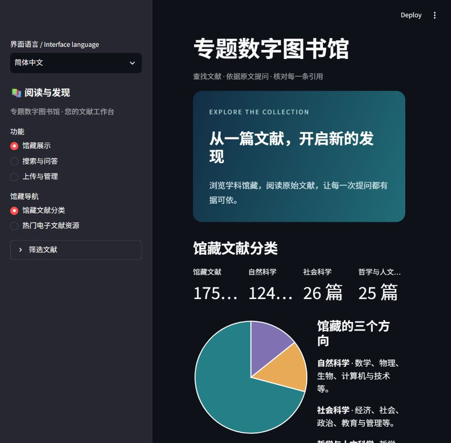

# 数字图书馆测试与交付物清单

2026-10-20核对的正式入口为 <http://127.0.0.1:18501/?lang=zh>。本机main、origin/main、GitHub main及正式部署代码均为 `446f7b5a18b4ebdcc83638618827c802f0416be8`，领先和落后均为0。583个部署文件逐一核对一致。本机main原先停在初始提交，已安全快进；正式应用和馆藏没有改动。

正式馆藏现有175篇，全部就绪，含4037个物理页、16,699个正文片段。界面显示自然科学124篇、社会科学26篇、人文25篇，待分类0篇。

## 两份清单

- [测试清单.xlsx](测试清单.xlsx)：31项测试工作、632条自动化展开用例，以及11项待办、观察或验证边界。每项标明结果、贡献归属与原始证据，专项和全量回归不重复计数。
- [交付物清单.xlsx](交付物清单.xlsx)：27项交付条目、426个文件差异及版本核对。通过状态列可区分已合并功能、本地数据、未合并记录与待补事项。

两份文件均使用微软雅黑，带筛选、冻结表头和证据链接。完整行数据另存[inventory.json](inventory.json)，便于后续整理个人报告或更新清单。

## 比较基线与计量

交付物比较范围为仓库首次Git提交 `65f168f45f2bf34ea204106e4e6e3250b56041a6` 至当前main `446f7b5`。主分支差异为新增360、修改29、移出37个路径。初始已有的检索、问答、增强识别和本机模型接入不记作后续从零新增；表中列出后续修复、扩展和交付方式调整。

最新组合回归的历史结果为632项通过、0失败/错误/跳过。逐项JUnit及工作项归属核对后，计为初始保留310项、后续新增322项；原330项中另有20项本机接入专用测试随PR8移出项目。受测提交为 `1973b4135c90877ab90b15e55d21d56e21d9674f`，其应用与测试文件树和当前main一致。本轮整理没有重新运行这632项测试。

## 代码与馆藏数据的位置

程序源码已与GitHub main一致。175份实际PDF、SQLite馆藏库、检索索引和本机模型接线保存在本地，不属于Git同步内容。PR13至PR16保存入库与检测记录，各自本地头提交与GitHub一致，继续保持Draft、未合并；其中的数据操作已在正式馆藏生效。

清单保留MQ-007、作者完整性、部分分类及年份观察、搜索卡片主题显示和PERF-001等事项。人工编目、外部OCR及重新识别的临时处理均按实际情况标注。演示视频目前未见交付记录，列为待补。

核对摘要见[sync-check.json](sync-check.json)，部署文件哈希见[deployed-source-hashes.json](deployed-source-hashes.json)，表格结构、公式、链接及显示核验见[verification.json](verification.json)。两份清单属于本次独立整理成果，不包含在上述既有版本的426个路径差异中。

