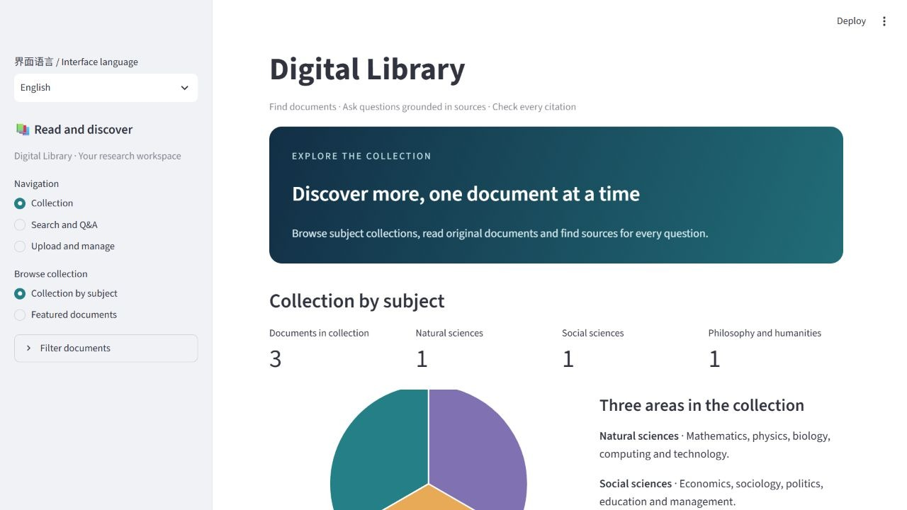
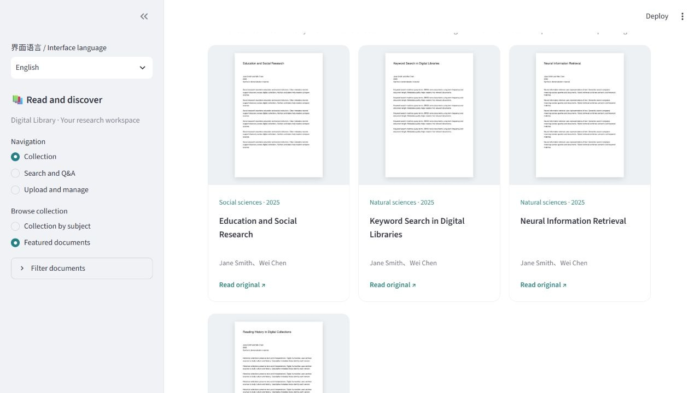
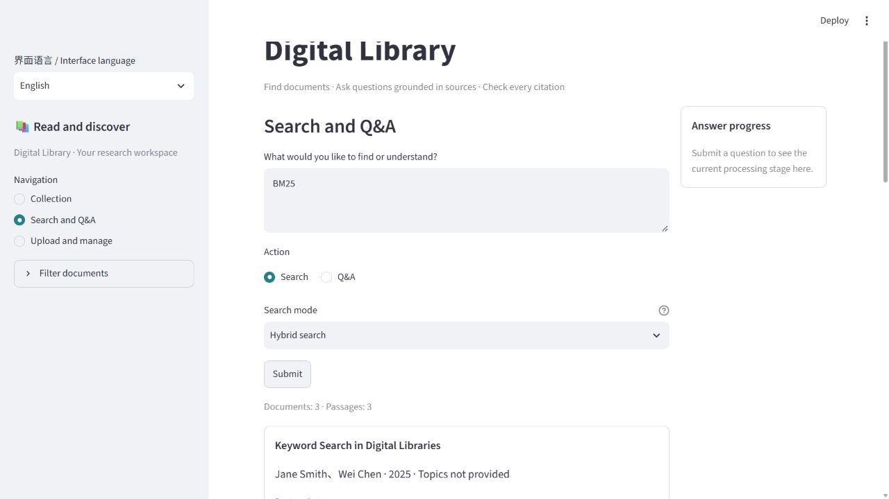
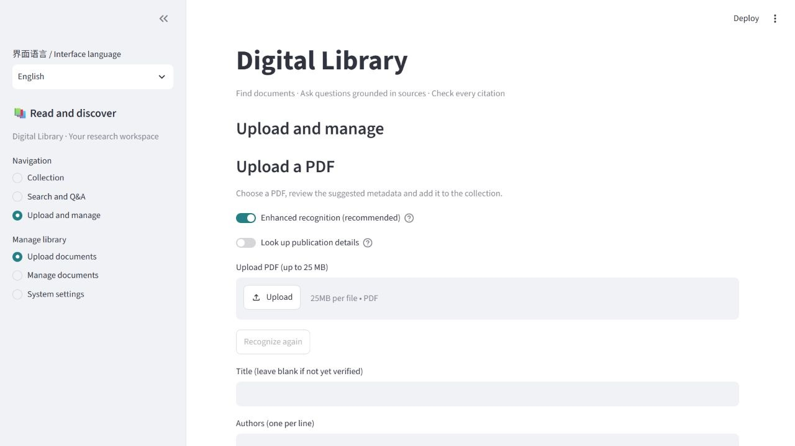
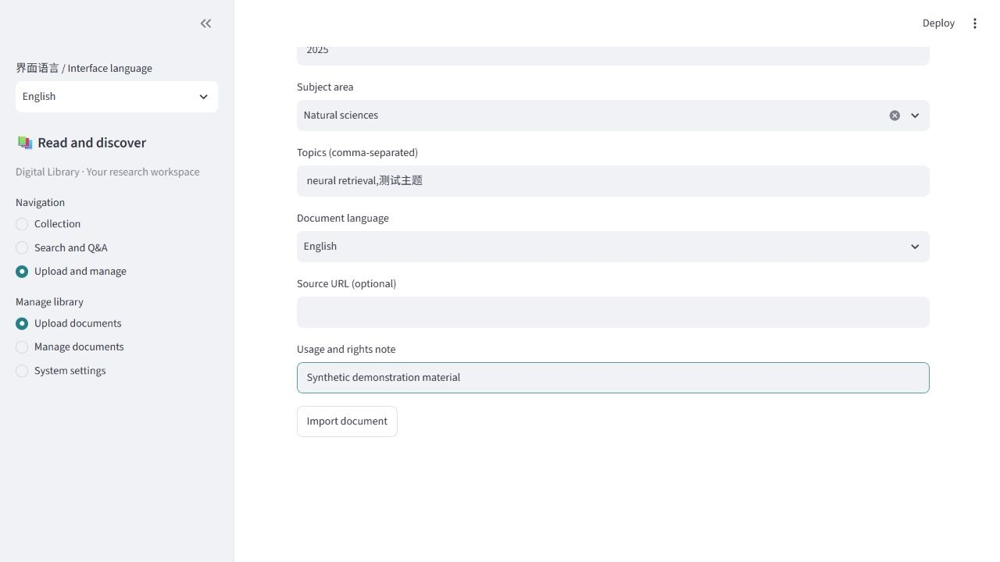
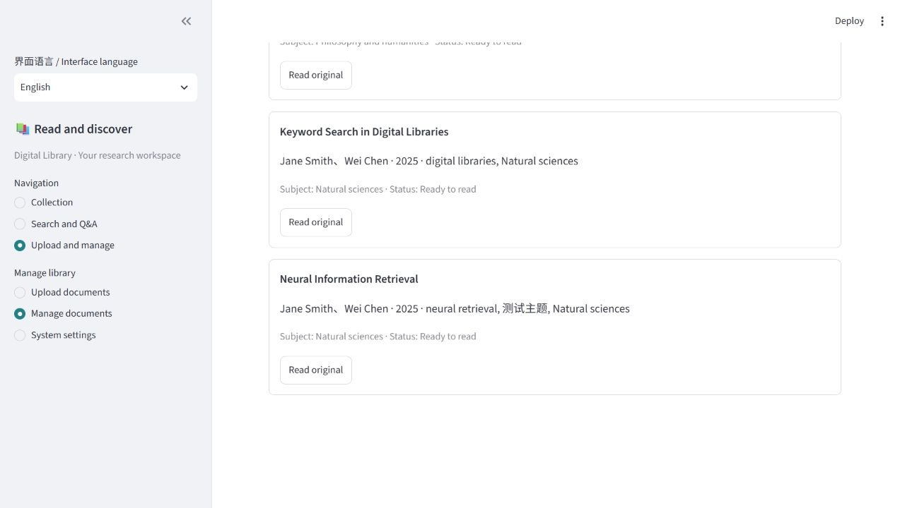
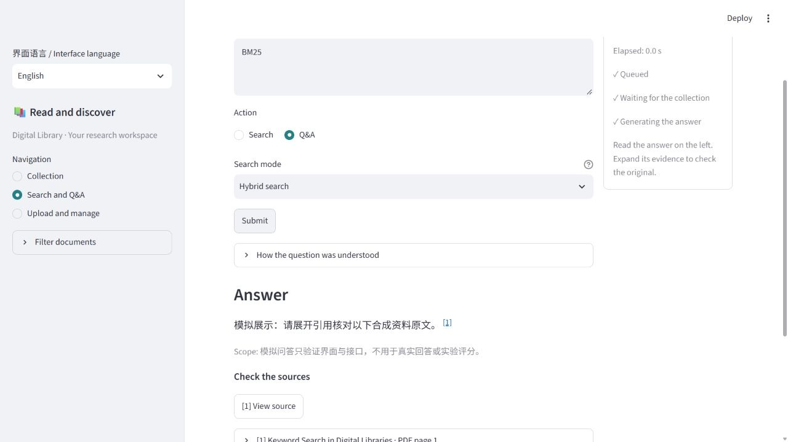
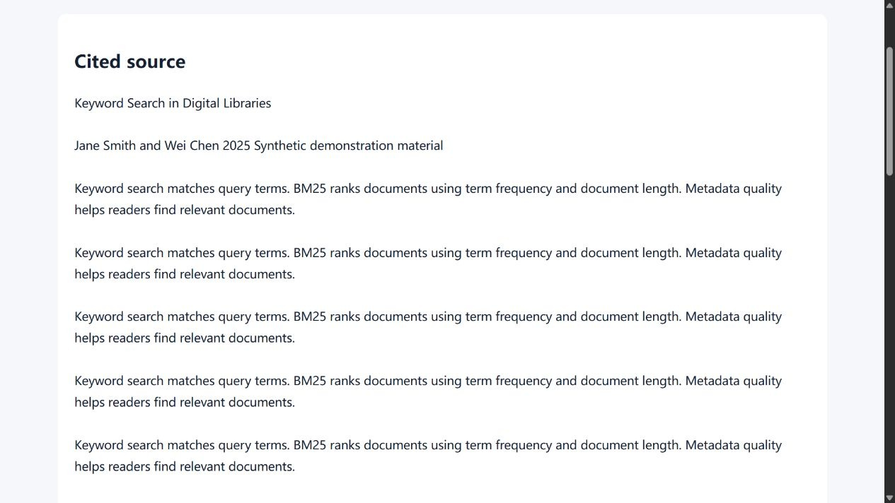

# Digital Library User Guide

Use the library to browse PDF collections, find relevant passages, add documents and ask questions with sources. This guide follows a typical reading and upload session.

Document version 1.3. Updated 19 October 2026. The new English screenshots use synthetic demonstration documents; the Q&A example is a scripted MOCK response.

## 1 Open the library and choose a language

Open the address supplied by your administrator. The default local installation uses `http://127.0.0.1:18501/`. At the top of the sidebar, choose **English** in **界面语言 / Interface language**.

Choose **简体中文** to return to Chinese. Switching keeps your current page, filters, search results, answer and upload draft. Document titles, authors, source text and existing answers keep their original language.

The page address remembers the choice when you refresh. Share an English entry point by adding `?lang=en` to the library address; use `?lang=zh` for Chinese. A new window without a language parameter starts in Chinese.

To start a local installation, run `./Start-Library.ps1 -Mode real` in the project folder. Follow the project installation instructions when setting it up for the first time.

<!-- pagebreak -->

## 2 Browse the collection

Choose **Collection → Collection by subject**. The counts and chart show the current collection across Natural sciences, Social sciences, and Philosophy and humanities. Use **Browse by subject** to focus on one area.

Choose **Featured documents** to browse PDF covers. Select a cover to open the original document. The order is a selection of library records rather than a readership ranking.

Expand **Filter documents** in the sidebar to set a year range or topics. Leave the years blank for any year and separate topics with commas. A document card shows its title, authors, year, topics and source link where available.

<!-- pagebreak -->

## 3 Search documents and read the results

Open **Search and Q&A**, enter a title, keyword or question in **What would you like to find or understand?**, select **Search**, and click **Submit**.

| Search mode | When to use it |
| --- | --- |
| Keyword search | You know a title, abbreviation or technical term, such as BM25 |
| Semantic search | You want to find passages about a meaning or idea |
| Hybrid search | You want to combine keyword and semantic matches; a useful starting point |

The result count lists documents and passages separately. Expand a passage to read it, then select **Open page** to continue in the PDF. Page numbers start at the first page of the PDF file. If the browser does not jump to that page, turn to the displayed number yourself.

If results are sparse, relax the year and topic filters or try a shorter query. Switching the interface language keeps the submitted results and your query.

<!-- pagebreak -->

## 4 Upload a PDF and review recognition

Choose **Upload and manage → Upload documents**, then select a PDF. The default file limit is 25 MB; the page displays the limit for your installation.

Keep **Enhanced recognition (recommended)** on to use the configured API to read the first two pages. The system suggests a title, authors and a version year. Progress and elapsed time appear while it works.

Expand **Suggestions and their sources** to compare each suggestion with the PDF. Check the full title and the complete author list in its original order. Fields that cannot be identified reliably can be filled in yourself.

Enable **Look up publication details** when you want to check a publication source. This searches Crossref with the title and first two author names. After changing recognition options, select **Recognize again** to update the suggestions. This replaces the suggested fields, so keep any edits you want to reuse first.

If a service is unavailable, follow the page message and enter the information from the PDF. The screenshot uses a demonstration environment with API recognition disabled.

<!-- pagebreak -->

## 5 Complete the catalogue information and import

Review the form before selecting **Import document**. The subject is suggested from keywords first; with enhanced recognition enabled, an LLM assists when keywords do not identify it. If it remains blank, choose the closest subject yourself.

| Field | What to enter |
| --- | --- |
| Title | The full title printed in the PDF |
| Authors | One author per line, in the original order |
| Version year | The year of this PDF version; leave blank if uncertain |
| Subject area | The closest of the three subject areas |
| Topics | Searchable terms, separated by commas |
| Document language | Chinese, English, Chinese and English, or Unknown |
| Source link | A document homepage or DOI link, if available |
| Usage and rights note | A relevant licence or intended use |

Preprints and revised versions can be included. Use the date of the version you collected, such as its public release or revision year. A related journal record may describe a different version, so compare it with the PDF before using its date.

After import, the system extracts body text and builds the search index. Language switching keeps the selected file and the form draft, and does not run recognition again.

<!-- pagebreak -->

## 6 Check the import status

Open **Upload and manage → Manage documents** and find the new document. When its status is **Ready to read**, it is available for browsing, search and questions.

| Status | What to do next |
| --- | --- |
| Ready to read | Search its title or open the PDF |
| Processing or Building search index | Wait for processing to finish, then refresh |
| Text review required (not searchable) | Check the indicated pages for scans or garbled text |
| Failed | Read the message, correct the problem and upload again |

For a body-text review message, open the indicated PDF pages. Use OCR for scanned pages or obtain a readable text-based copy, then upload the corrected file. Uploading an identical PDF again keeps the existing record. Ask the maintainer if an existing record needs a metadata correction.

<!-- pagebreak -->

## 7 Ask a question and check its sources

In **Search and Q&A**, choose **Q&A**, write a question about a document in the collection and click **Submit**. Name the document and the point you want to understand. Each question is processed separately, so include that context again for a follow-up.

The right column shows actual processing stages and elapsed time. Once the answer appears, expand **How the question was understood** to see the search interpretation. Read any notes about missing evidence or the scope of the answer. If asked to clarify, select an option and submit it.

Click a citation number to open its source, or use **View source** to expand the evidence on the page.

An interface switch preserves the answer in its original language. The screenshot shows a Chinese scripted demonstration answer inside the English interface.

<!-- pagebreak -->

## 8 Read the cited source

In an evidence card, select **View highlighted source and PDF page**. This opens the extracted source text and a preview of its original PDF page. The source page follows the language of the link you opened.

When sentence locations are available, yellow highlights identify the sentences supporting that citation. Read them with the surrounding paragraphs to judge whether the answer reflects the source. Use **Open original PDF** to keep reading the full document.

The demonstration answer shown here has no sentence locations, so its source page explains that no highlighting is available. Answers with sentence locations open the same page with those sentences marked.

<!-- pagebreak -->

## 9 Common problems and demonstration tips

| What you see | What to try |
| --- | --- |
| The page does not open | Check the address and confirm the library is running |
| Backend connection error | Run `./Status-Library.ps1 -Mode real` in the project folder |
| Recognition does not finish | Retry later or fill in the fields from the PDF |
| Incomplete title or author list | Correct the fields before import |
| No useful search results | Relax filters and try the title or keywords |
| Body text needs review | Check the listed pages and use OCR or a corrected copy |
| Too little evidence for an answer | Name the document and narrow the question, or add relevant material |

**System settings** displays the service mode, active models and current index. A MOCK service uses synthetic material and scripted answers for demonstrations; a REAL service uses the configured model services.

For a short demonstration, browse a subject collection, search a title, open a matching page, upload a PDF, review its metadata, confirm the import status, then ask a question and check its citation. Switch between Chinese and English while a query or form is filled in to show that your work is preserved. This sequence fits a six to eight minute operation video.
