# 专题数字图书馆使用手册

在图书馆中，你可以浏览 PDF 馆藏、搜索相关文献，也可以围绕馆藏内容提问，并通过回答中的引用阅读原文。本手册按实际使用顺序介绍这些操作。

文档版本为 1.3，更新日期为 2026 年 10 月 20 日。

## 1 开始使用

在浏览器打开管理员提供的图书馆地址。本机安装的默认入口是 http://127.0.0.1:18501/ 。进入首页后，可在左侧“界面语言 / Interface language”中选择“简体中文”或“English”，再选择要使用的功能。语言切换只更换界面文字。

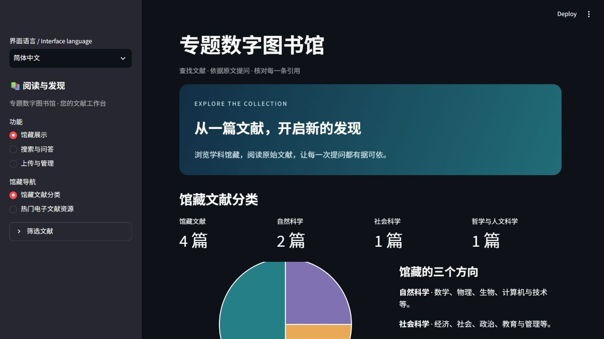

“馆藏展示”用于浏览文献，“搜索与问答”用于查找资料和提问，“上传与管理”用于添加文献、核对信息和查看入库状态。

如果你负责在本机启动系统，在项目文件夹中运行 `./Start-Library.ps1 -Mode real`，再打开上面的地址。首次安装请按项目首页的安装说明完成配置。

<!-- pagebreak -->

## 2 浏览馆藏

选择“馆藏展示 → 馆藏文献分类”。页面顶部展示馆藏数量和学科分布；在“浏览所属学科”中选择自然科学、社会科学或哲学与人文科学，可以缩小浏览范围。

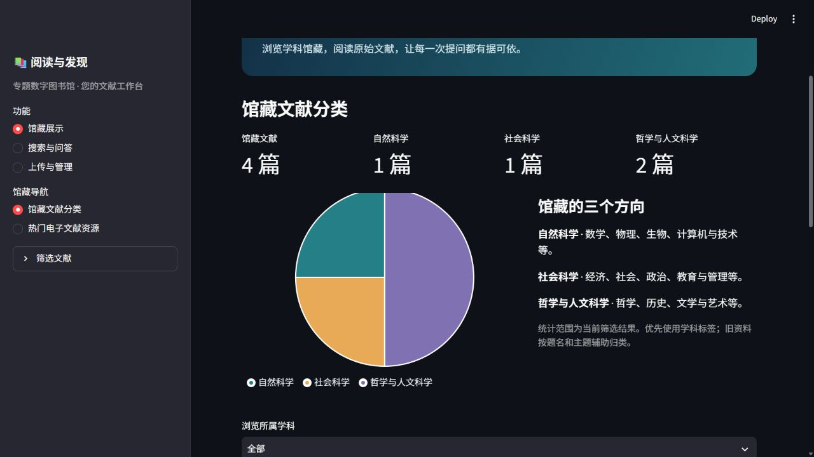

文献卡片会列出题名、作者、年份、主题和来源。找到感兴趣的文献后，点击“阅读原文 ↗”打开 PDF。

喜欢按封面寻找资料时，可以切换到“热门电子文献资源”，点击封面或文献卡片进入原文。

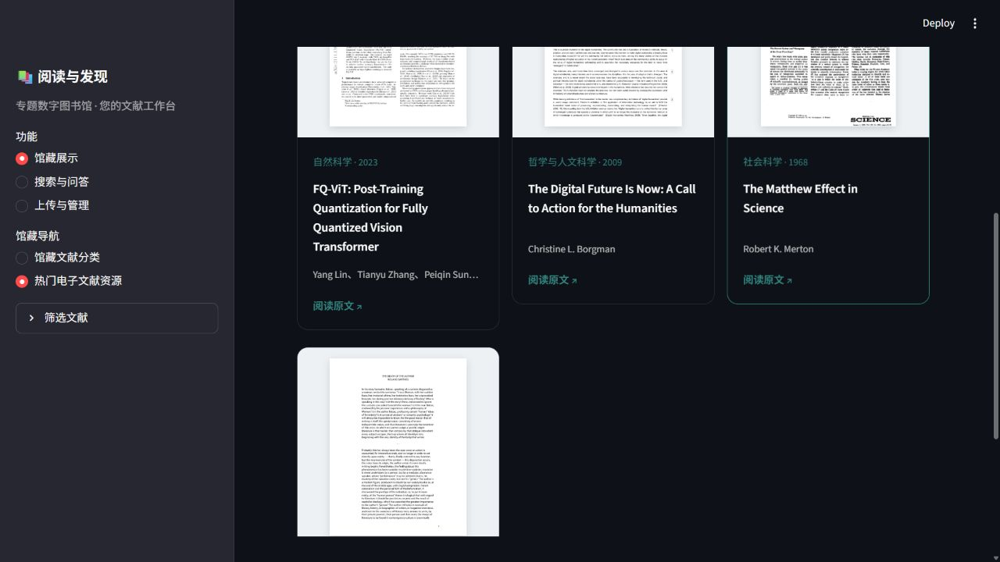

<!-- pagebreak -->

## 3 搜索文献

进入“搜索与问答”，在“想查找或了解什么？”中输入题名、关键词或想了解的内容，将“操作”选为“搜索”，然后点击“提交”。第一次搜索可以使用默认的“混合检索”。

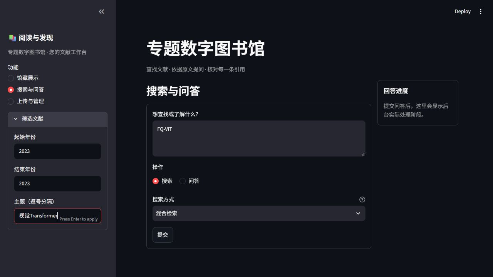

| 方式 | 什么时候用 | 示例 |
| --- | --- | --- |
| 关键词检索 | 已知题名、缩写或专业术语 | FQ-ViT |
| 语义检索 | 想按含义寻找资料 | 视觉模型怎样做低比特量化 |
| 混合检索 | 同时参考关键词和内容含义 | FQ-ViT 的 LayerNorm 量化 |

需要缩小范围时，在左侧展开“筛选文献”，填写起止年份或主题。年份留空表示不限年份；多个主题用逗号分隔。填写后按 Enter，再提交搜索。

例如，寻找某篇文献的修订版时，可以用题名配合版本年份筛选。若结果太少，先放宽年份和主题，再尝试更简短的关键词。

<!-- pagebreak -->

## 4 阅读搜索结果

结果顶部显示命中的文献数和片段数。同一篇文献的内容集中在一张卡片中，便于比较和阅读。

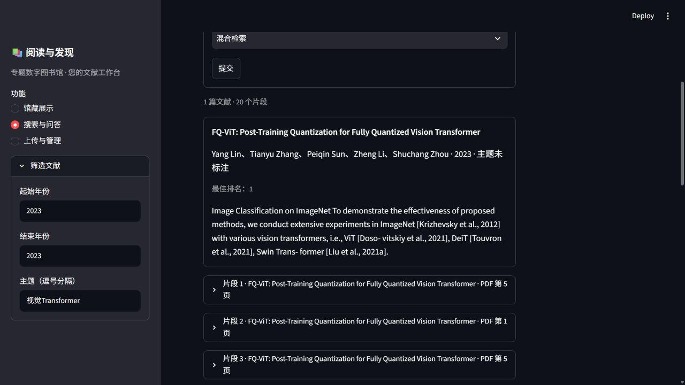

1. 浏览题名、作者、年份和预览文字，选择感兴趣的文献。
2. 展开“片段”，阅读与搜索内容相关的段落。
3. 点击“打开该页”，继续阅读对应的 PDF 页面。
4. 想换一个角度查找时，修改关键词或检索方式，再次提交。

页面中的页码从 PDF 文件的第一页开始计算。若浏览器打开文件后没有跳到指定页面，按卡片显示的页码手动翻页即可。

一篇文献可以命中多个段落，所以片段数通常多于文献数。

<!-- pagebreak -->

## 5 上传 PDF

进入“上传与管理 → 上传文献”，点击“Upload”选择 PDF。系统一次处理一份文献，默认支持 25 MB 以内的文件。

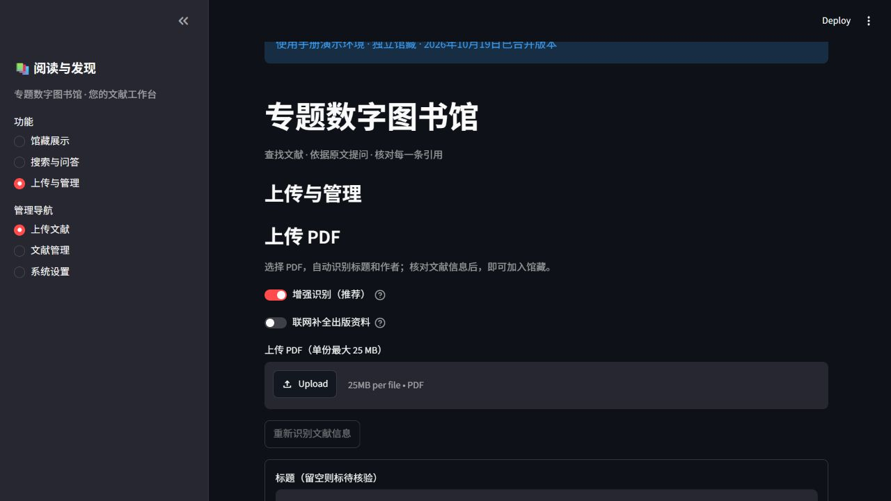

保持“增强识别（推荐）”开启，系统会读取 PDF 前两页的图像和文字，填写题名、作者、年份等信息。上传后，页面会显示识别进度和已用时间。

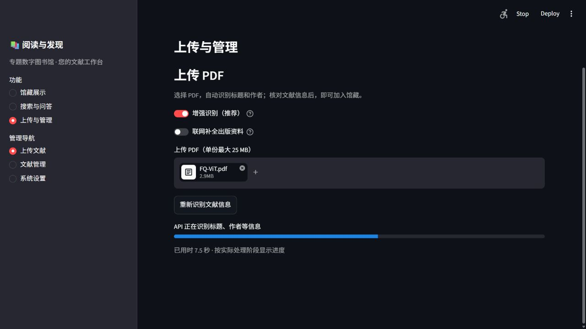

需要补充出版来源时，勾选“联网补全出版资料”。系统会用题名和前两位作者姓名查询 Crossref，补充可匹配的书目信息。更改识别选项后，点击“重新识别文献信息”更新结果。

识别完成后，向下查看表单，按下一节核对信息。如果识别未完成，也可以直接对照 PDF 填写。

<!-- pagebreak -->

## 6 核对识别结果

展开“识别结果与来源”，可以看到每个字段的识别结果、所在页码和参考文字。对照 PDF 首页检查题名与作者，再确认年份和来源。

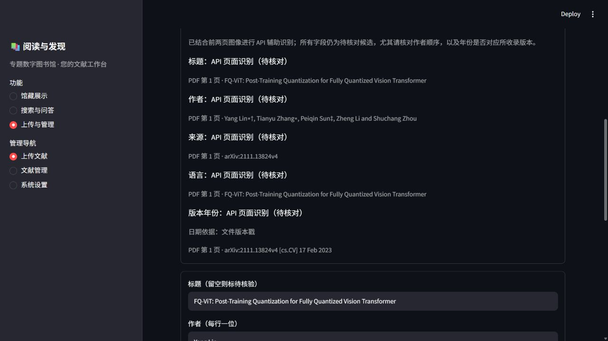

题名应包含完整的主标题和副标题。作者按原文顺序填写，每行一位；名单较长时，滚动查看后面的姓名。

年份填写当前这份 PDF 对应的版本年份。预印本、公开稿和修订版都可以收录。例如，图中的文件带有“17 Feb 2023”版本日期，填写 2023 即可。暂时找不到年份时，可以留空，其他信息照常填写。

如果联网补全找到了不同年份的出版记录，可以先比较它与手中 PDF 的版本，再决定采用哪一项。

<!-- pagebreak -->

## 7 填写编目信息

在表单中修正识别结果，选择所属学科，并补充主题、语言等信息。下面的表格可以作为填写时的参考。

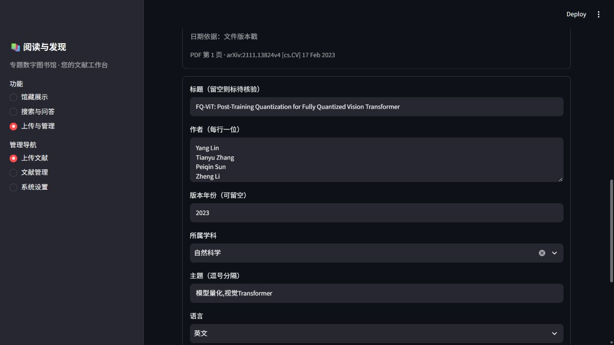

| 字段 | 填写示例或方法 |
| --- | --- |
| 标题 | 按 PDF 首页填写完整题名 |
| 作者 | 每行一位，保持原文顺序 |
| 版本年份 | 如 2023；暂不确定时留空 |
| 所属学科 | 选择最贴近文献内容的学科 |
| 主题 | 如“模型量化,视觉Transformer” |
| 语言 | 中文、英文、中英混合或未确定 |
| 来源链接 | 文献主页或 DOI 地址，可留空 |
| 使用说明 | 如“课程研究使用”及适用的许可信息 |

确认后点击“导入文献”。系统会解析正文并建立检索索引，完成后可在“文献管理”查看状态。

“重新识别文献信息”会重新填写识别字段。已经手工修改表单时，先保留需要的内容，再重新识别。

<!-- pagebreak -->

## 8 查看入库状态

进入“上传与管理 → 文献管理”，找到刚添加的文献。状态为“可阅读”时，就可以在馆藏中浏览、搜索和提问。

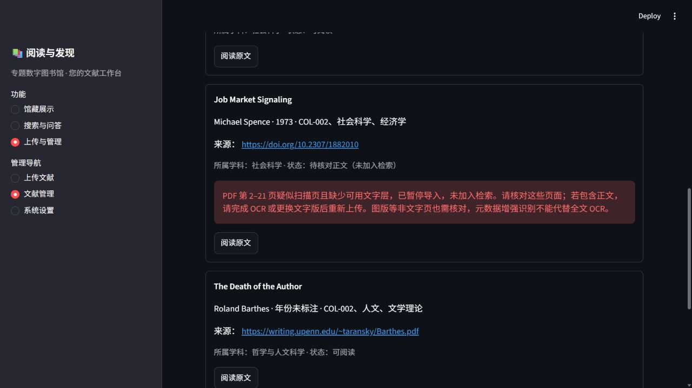

| 状态 | 接下来怎么做 |
| --- | --- |
| 可阅读 | 用题名搜索文献，打开原文阅读 |
| 处理中或正在建立检索 | 等待处理完成，再刷新查看 |
| 待核对正文 未加入检索 | 打开提示页码，检查扫描页或乱码 |
| 处理失败 | 查看错误提示，处理后重新上传 |

“待核对正文”通常表示部分页面缺少可提取文字，或提取出的文字存在乱码。图中提示了需要检查的具体页码。打开 PDF 查看这些页面，需要时使用 OCR 工具识别文字，或换用文字清晰的版本后重新上传。

重复上传同一份 PDF 时，系统会保留已有文献记录。如果需要修改已入库的编目信息，可联系维护者处理。

<!-- pagebreak -->

## 9 向馆藏提问

进入“搜索与问答”，将“操作”改为“问答”，输入问题并点击“提交”。系统会从馆藏中寻找相关内容，组织回答，并为回答附上引用。

例如，馆藏已有 FQ-ViT 论文时，可以问：“FQ-ViT 中 Power-of-Two Factor 解决什么问题？请用两句话概括，并引用原文。”也可以把题名和问题换成你正在阅读的文献。

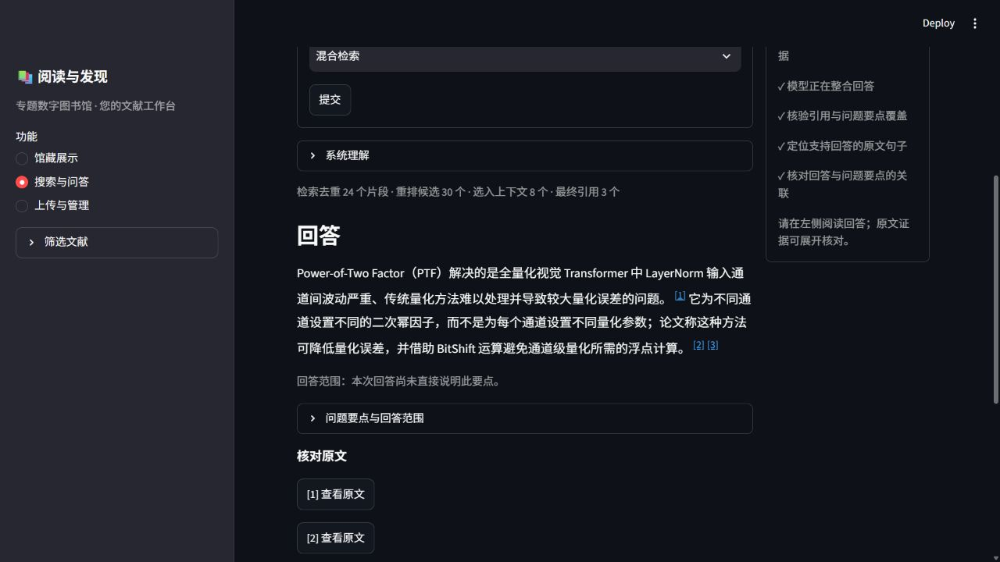

右侧会依次显示理解问题、检索、选择证据和整理回答等进度。完成后，先阅读回答，再展开“系统理解”和“问题要点与回答范围”，查看系统如何理解这次提问。

每次提问单独处理。继续追问时，在问题中写明文献和讨论对象，会更容易得到相关回答。如果系统需要澄清，选择合适的选项后再次提交；如果馆藏内容不足，可以缩小问题范围，或补充相关文献后再问。

<!-- pagebreak -->

## 10 查看引用和原文

点击回答中的引用角标，可以打开对应的原文页。也可以在“核对原文”中点击“[1] 查看原文”，先阅读证据卡片中的支持文字和文献信息。

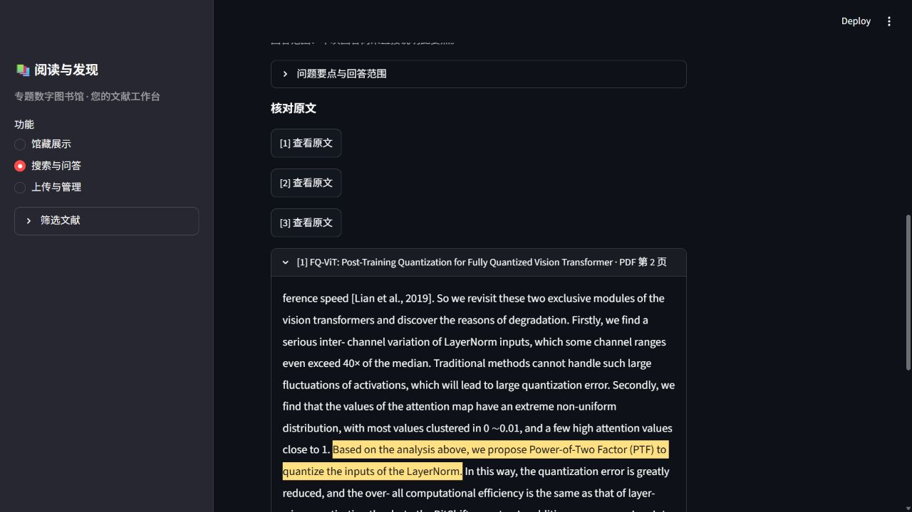

在证据卡片中点击“查看高亮原文与 PDF 原页”，进入原文页面。黄色区域标出了回答引用的句子，下方提供对应的 PDF 页面预览。

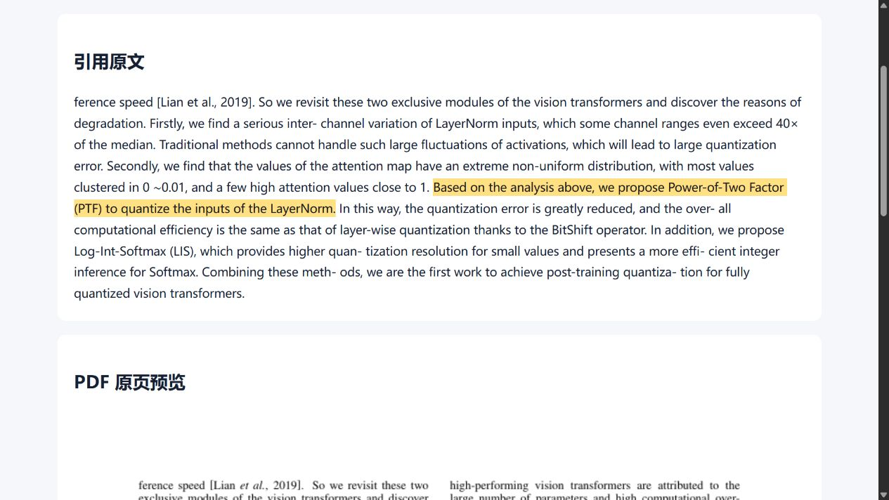

阅读高亮句子及前后段落，可以判断回答是否符合原意。想继续阅读全文时，点击“打开 PDF 原文件”。

<!-- pagebreak -->

## 11 常见问题和演示顺序

| 遇到的情况 | 处理方法 |
| --- | --- |
| 网页打不开 | 确认图书馆已启动，并检查浏览器地址 |
| 提示后端连接失败 | 在项目目录运行 `./Status-Library.ps1 -Mode real` 查看状态 |
| 识别没有完成 | 稍后点击“重新识别文献信息”，或对照 PDF 填写表单 |
| 题名或作者识别不完整 | 在导入前直接修改对应字段 |
| 搜索不到资料 | 放宽年份与主题筛选，再用题名或关键词搜索 |
| 提示正文待核对 | 查看提示页码，完成 OCR 或更换 PDF 后重传 |
| 问答提示证据不足 | 写清问题中的文献和主题，或补充相关馆藏 |
| 已入库的信息需要修改 | 联系维护者调整现有记录 |

演示系统时，可以选一篇文献，把下面几个步骤连起来：

1. 从馆藏首页浏览学科分类，打开一篇文献。
2. 用题名搜索，再尝试语义或混合检索，并打开命中页。
3. 上传一份 PDF，查看增强识别结果，修正信息后导入。
4. 在文献管理确认“可阅读”，再搜索新加入的文献。
5. 提出一个与该文献有关的问题，展开引用并阅读高亮原文。

这条流程适合录制约 6 至 8 分钟的操作视频。讲解时可结合题名、作者和年份的核对，说明文献信息质量如何影响查找和阅读体验。
