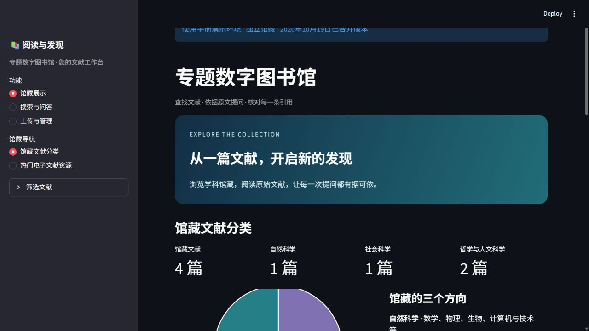
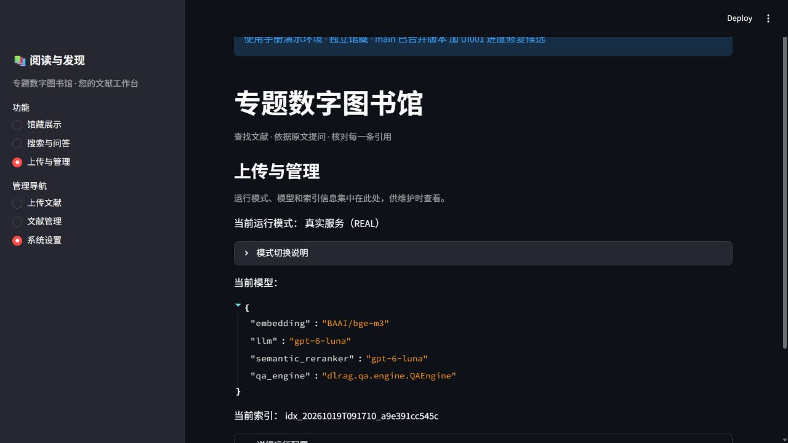

# 专题数字图书馆使用手册

本文面向文献使用者、馆藏维护者与课堂演示者，说明如何浏览馆藏、搜索文献、依据原文提问，以及上传并核对 PDF。操作截图来自实际运行的独立演示馆藏，可按图中按钮逐步完成。

文档版本为 1.0，编写日期为 2026 年 10 月 19 日。主功能截图依据 PR1 至 PR5 的版本；问答实拍使用 [UI001 进度修复 PR6](https://github.com/Dan1un1u/digital-library-rag/pull/6)。PR6 已通过验收合入 main；截图保留拍摄时的“修复候选”标记，现有正式实例尚未更新到截图版本。



第一次使用，可依次完成：从左侧打开“馆藏展示”；在“搜索与问答”输入一个题名并选择“搜索”；找到结果后阅读原文。上传文献前，先看本手册第 6 至 9 节；录制视频可直接使用第 12 节的演示顺序。

阅读导航：第 2 节打开系统；第 3 节浏览馆藏；第 4 至 5 节搜索；第 6 至 9 节上传与审核；第 10 至 11 节问答与引用；第 12 节故障处理与视频；第 13 节维护及工作记录。

<!-- pagebreak -->

## 2 打开系统与确认版本

本机现有正式使用入口是 http://127.0.0.1:18501/ 。本手册的实拍入口是 http://127.0.0.1:19520/ ，页面上方显示“使用手册演示环境”。这两个入口使用不同馆藏，数量和内容不同是正常现象。

已配置好的部署，在其项目根目录运行以下命令即可启动真实模式。首次安装或更换电脑请先阅读仓库安装说明；不能仅凭一份手册目录直接启动。

```powershell
.\Start-Library.ps1 -Mode real
```

进入“上传与管理 → 系统设置”，确认运行模式为“真实服务（REAL）”，模型显示 BAAI/bge-m3 和 gpt-6-luna，当前索引不是“暂无”。出现服务提示时，先按提示检查，再进行上传或提问。



| 入口 | 用途 | 数据说明 |
| --- | --- | --- |
| 18501 | 现有正式使用界面 | 保留原部署与馆藏 |
| 19501 | 既有跨学科 dev 界面 | 历史检测基线，含质量问题样本 |
| 19520 | 本手册演示界面 | 独立小馆藏，含两份正文审核示例 |
| 18502 | MOCK 流程演示 | 合成资料与脚本问答，不代表真实模型效果 |

REAL 表示使用真实服务，不意味着所有推理都在本机。BGE 在本机生成向量，Luna 推理仍通过已配置的云端服务完成。

<!-- pagebreak -->

## 3 浏览馆藏与阅读文献

在左侧选择“馆藏展示 → 馆藏文献分类”。顶部数字与饼图显示当前筛选范围内的馆藏分布；向下找到“浏览所属学科”，可选择自然科学、社会科学、哲学与人文科学、全部或待分类。


每条文献显示题名、作者、版本年份、主题和来源。点击“阅读原文 ↗”打开 PDF。年份没有可靠依据时允许留空；“年份未标注”不会阻止质量合格的正文进入馆藏。

切换“热门电子文献资源”可按 PDF 首页封面浏览，点击封面或卡片阅读原文。该页面尚未统计访问热度，排列顺序不代表阅读量排名。


<!-- pagebreak -->

## 4 选择检索方式并提交搜索

进入“搜索与问答”，在“想查找或了解什么？”中输入题名、术语或自然语言需求，将“操作”选为“搜索”，选择检索方式，点击“提交”。初次使用可先采用默认的“混合检索”。


| 搜索方式 | 适用情况 | 示例 |
| --- | --- | --- |
| 关键词检索 | 已知准确题名、缩写或专业术语 | FQ-ViT |
| 语义检索 | 表达与原文用词不同，希望按含义寻找 | 视觉模型怎样做低比特量化 |
| 混合检索 | 同时利用关键词与语义线索 | FQ-ViT 的 LayerNorm 量化 |

左侧展开“筛选文献”，可填写起始年份、结束年份和主题。年份需为整数，起始年份不能晚于结束年份；不限制时留空。主题按馆藏已有标签填写，多个主题用逗号分隔。填写后按 Enter 或移开焦点使筛选生效，再提交搜索。

图中使用 2023 至 2023 年及“视觉Transformer”主题，对应所收录的 FQ-ViT 修订版本。这里筛选的是馆藏的版本年份。找不到文献时，先清空筛选再试，尤其注意年份为空的资料可能被年份条件排除。

<!-- pagebreak -->

## 5 阅读搜索结果与定位页面

提交后，先看结果顶部的文献数与片段数。文献卡片将同一文献的结果聚合展示；下方各片段带有排名、题名和 PDF 文件页码。搜索结果用于帮助发现资料，仍需打开正文判断是否满足需求。


1. 查看题名、作者、年份和预览文字，确认结果是否相关。
2. 展开所需的“片段”，阅读该段完整提取文字。
3. 点击“打开该页”，在浏览器中查看对应 PDF。
4. 如果检索结果不合适，调整关键词或检索方式，清除过窄的筛选条件后再次提交。

页码按 PDF 文件第一页开始计数，可能与论文印刷页码不同。搜索结果的“打开该页”依赖浏览器对页码链接的支持；未自动跳转时，按显示的 PDF 文件页码手动定位。这一入口不提供问答支持句高亮。

同一篇文献可能命中多个片段，因此片段数量大于文献数量并不表示重复入库。图中的排名、条数和用时只描述本次演示，不能作为整体检索准确率。

<!-- pagebreak -->

## 6 选择 PDF 并进行增强识别

进入“上传与管理 → 上传文献”。准备一份有权用于本项目的 PDF，核对文件完整性，再点击“Upload”选择文件。当前单份文件上限为 25 MB，界面一次处理一份文献。


默认开启“增强识别（推荐）”。它将 PDF 前两页的图像和文字交给已配置的模型服务，辅助识别题名、作者、语言、来源和版本年份。上传后会显示实际阶段与用时，等待识别完成再核对表单。


“联网补全出版资料”默认关闭。开启后会将题名和前两位作者姓名发送至 Crossref 查询，不发送 PDF，用于补充出版来源及满足版本条件的缺失信息。更改识别选项后，点击“重新识别文献信息”使选项应用到当前文件。

关闭增强识别后，系统只尝试本机提取。两种方式都只是元数据预填，不能替代全文 OCR。增强服务失败时，可能保留本机候选；此时按页面提示人工核对，不能把它视为增强识别已成功。

<!-- pagebreak -->

## 7 核对识别来源和版本年份

识别完成后展开“识别结果与来源”，按字段查看识别方法、PDF 页码及依据文字。识别预览本身不会将文献加入可检索馆藏，仍需检查下方表单并点击“导入文献”。


**题名与作者。** 对照 PDF 首页，检查完整题名、作者总数、姓名拼写和顺序。作者框每行一位；作者较多时要在输入框中滚动检查，不能只核对可见的前几行。

**版本年份。** 填写与当前收录 PDF 对应的年份。预印本、公开稿和修订版均可收录；无需为了填写正式发表年份而更换已有明确的版本年份。图中的 FQ-ViT 文件标有“17 Feb 2023”的版本戳，因此本次填写 2023。

**依据不足时。** 允许年份留空；不要将参考文献年份、文件下载时间或无关版权年份猜作本文件年份。外部出版记录与文件版本不一致时，先保留文件版本信息并人工核对，不能直接覆盖。

如果开启联网补全，界面可能显示相关出版记录或冲突。补全结果仍是候选。外部服务没有匹配到记录，并不表示这份论文不能收录。

<!-- pagebreak -->

## 8 填写编目信息并导入

在表单中修正候选信息，选择一个所属学科，补充主题和使用说明，然后点击“导入文献”。“重新识别文献信息”会重新预填识别字段，可能替换人工修改；手工修订后不要随意再次识别。


| 字段 | 填写方法 |
| --- | --- |
| 标题 | 与 PDF 一致；留空会标为待核验，不推荐作为常规做法 |
| 作者 | 每行一位，保留原始顺序；滚动检查长名单 |
| 版本年份 | 整数或留空，与本 PDF 版本对应 |
| 所属学科 | 必选，从三个学科方向中选择一项 |
| 主题 | 用逗号分隔，如“模型量化,视觉Transformer” |
| 语言 | 选择中文、英文、中英混合或未确定 |
| 来源链接 | 可选，填写可核对的来源或 DOI 地址 |
| 使用说明 | 如实说明用途和许可条件，不把“公开可下载”等同于可再分发 |

点击导入后，系统解析正文、准备检索并建立索引。等待结果提示，再到“文献管理”确认状态。识别进度完成与正文入库成功是两个不同阶段，不能只凭识别完成判断文献已经可检索。

<!-- pagebreak -->

## 9 确认入库并处理正文审核

进入“上传与管理 → 文献管理”，检查刚导入的题名和状态。只有“可阅读”的文献进入公开馆藏与检索；管理页也会保留未完成和待核对的记录，便于查原因。


| 显示状态 | 含义与下一步 |
| --- | --- |
| 可阅读 | 已完成入库；到搜索页用题名验证，并打开原文检查 |
| 处理中或正在建立检索 | 等待完成，避免连续重复上传 |
| 待核对正文 未加入检索 | 按提示核对具体页码，修复 OCR 或文字层后重传 |
| 处理失败 | 阅读原因；排查文件、服务或配置后再处理 |

图中 Job Market Signaling 的第 2 至 21 页缺少可用文字层，因此停止导入。Modern Moral Philosophy 的文字层疑似乱码，同样需要核对。这两份原件专用于展示审核提示，通过现有接口准备，不是本轮在浏览器中逐份上传的实验。

请打开原 PDF，检查页面是否有正文、是否扫描、复制出来的文字是否正常。需要时用外部工具做 OCR 或换用可提取文字的版本，再逐页抽查正文顺序和完整性。本项目没有“一键忽略审核”或内置全文 OCR 按钮。

同一 PDF 重复导入会保留已有记录及原元数据，不能用重传同一文件来修改既有编目。当前界面没有直接修改已入库元数据、删除馆藏或批量审批的入口，需要维护者另行处理。

<!-- pagebreak -->

## 10 发起有证据的问答

进入“搜索与问答”，将“操作”改为“问答”，输入一个范围明确的问题并点击“提交”。“搜索方式”下拉框用于搜索操作；问答会自动组织检索。当前每次提交都是独立请求，补问时请保留必要上下文。

可复用示例：FQ-ViT 中 Power-of-Two Factor 解决什么问题？请用两句话概括，并引用原文。


右侧依次显示理解问题、检索、选择证据、整合回答、核验引用与句子定位等阶段。模型响应速度会变化，演示中的约 34 秒不是时限承诺。等待期间不要连续提交；超过等待时限时，先查看状态再决定重试。

回答显示后，展开“系统理解”检查系统是否正确理解问题，再阅读“问题要点与回答范围”和限制提示。若要求澄清，选择选项或补充说明后重新提问；若提示证据不足，先补充馆藏或缩小问题，不应将没有证据的内容作为结论。

本节实拍时 PR6 仍为修复候选，现已通过验收合入 main。旧版本在较慢阶段可能因进度区重复标识报错；部署更新前仍可能遇到该问题，本节截图不代表旧实例已更新。

<!-- pagebreak -->

## 11 核对引用并查看 PDF 原页

点击回答中的引用角标，可打开对应的原文页。也可先点击“核对原文”下的“[1] 查看原文”，展开同编号证据卡片，阅读支持文字、作者、版本年份和 PDF 文件页码。


在证据卡片点击“查看高亮原文与 PDF 原页”，进入独立核验页。黄色区域是该引用选中的支持句子，下方提供对应 PDF 原页预览；点击“打开 PDF 原文件”可继续阅读完整上下文。


核对时依次确认文献、文件页码、支持句与上下文。出现高亮不等于结论必然正确；原文是否支持回答仍需读者判断。遇到索引版本变化导致旧链接失效，应重新搜索或提问获取当前引用。PDF 页码始终按文件计数。

<!-- pagebreak -->

## 12 常见问题与视频演示顺序

| 遇到的情况 | 建议处理 |
| --- | --- |
| 网页打不开或提示后端连接失败 | 检查访问入口和服务状态；不要随意结束占用端口的其他进程 |
| 增强识别超时或未成功 | 检查 Luna 服务与网络；阅读提示，核对保留下来的本机候选或稍后重试 |
| 题名作者不完整或年份为空 | 对照当前 PDF 人工填写；有依据再填年份 |
| 搜索结果为空 | 清空年份与主题限制，再用准确题名和关键词搜索 |
| 正文待核对 | 按页码检查扫描或乱码，完成外部 OCR 或更换版本后重传 |
| 问答页面报重复标识错误 | PR6 已合入 main；核对是否仍在运行旧版本，交由维护者部署更新 |
| 重传后元数据没有变化 | 同一文件去重保留原记录；需要维护者处理，不要重复提交 |

建议录制 6 至 8 分钟的操作视频，按以下顺序展示。录制前先完整预演一次，准备一份正常 PDF 和一份已知扫描问题样本；按实际情况呈现等待与失败。

1. 约 40 秒：说明项目用途，展示当前环境、运行模式和馆藏分类。
2. 约 60 秒：用准确题名搜索，再演示年份或主题筛选及 PDF 页码定位。
3. 约 2 分钟：上传 PDF，展示增强识别，解释来源、作者顺序和版本年份，再提交导入。
4. 约 60 秒：在文献管理确认“可阅读”，搜索新题名并打开原文。
5. 约 2 分钟：提交一个明确问题，展示实际进度、回答角标及高亮原文核验。
6. 约 40 秒：展示“待核对正文”的页码提示，说明人工复核与外部 OCR 的边界。

录制内容不应包含私有配置、登录凭证或代理口令。可以剪短等待，但需说明有剪辑；单次演示成功不能替代正式评测。课程要求个人讲解 10 至 15 分钟，可另用 4 至 7 分钟解释元数据质量评价方法、缺陷与修复证据。

<!-- pagebreak -->

## 13 维护入口与可追溯记录

日常使用以浏览器界面为主。维护者可在已配置的部署根目录查看状态、启动或停止所需模式。停止前等待正在进行的上传与问答结束；图书馆停止脚本不等同于停止共享模型服务。

```powershell
.\Status-Library.ps1
.\Start-Library.ps1 -Mode real
.\Stop-Library.ps1 -Mode real
```

独立文档演示环境不使用上述正式端口启动入口。拍摄记录及数据位置见同目录的 verification.json，本轮验收见 acceptance-20261019.json；正式馆藏与历史 dev 数据未迁移或重建。

**记录一次馆藏新增。** 为批次指定工作项与环境，保留原文件哈希、识别候选、人工修改及理由、最终元数据、导入状态、题名检索结果和正文抽查页码。注明谁实际核查了哪些内容，区分人工审核、模型辅助与自动检查。

**记录一次缺陷修复。** 保存可复现输入、失败现象、原因、修复提交、目标检查和回归结果。每项修复独立分支、独立 PR；使用手册也作为独立文档工作项提交，审核后再决定合并。

本手册的页面截图均由真实浏览器采集，没有绘制或伪造成功页面。演示正常馆藏为 4 篇，另有 2 篇待核对记录；早期首页截图只有 4 篇，后续管理页显示 6 条记录，差异来自审核样本的加入。问答取自真实 BGE 与 Luna 调用，未将 MOCK 结果充作真实结果。

**版本与边界。** 主功能截图基线为 b9565b482d8cf4f085235c9aba2d18e8303554ee，问答界面使用 UI001 提交 a401cf5。PR6 已验收合并，截图及首版核验记录仍保留当时身份；本轮更新文档状态并记录新输出哈希。旧的 18501 或 19501 实例尚未部署更新，本文也未重新执行总体检索准确率或回答质量评测。

维护参考：仓库根 README.md；本地模型使用说明.txt；docs/workflow/catalog-ingestion.md；docs/workflow/test-task-isolation.md。PDF 文献、数据库、索引和认证配置不随文档 PR 分发。
