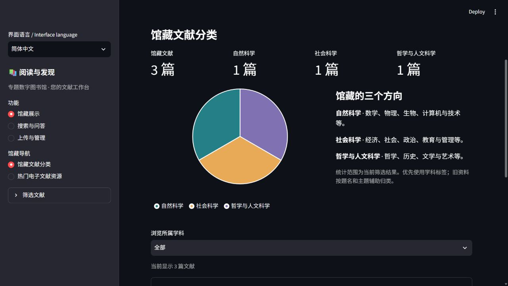
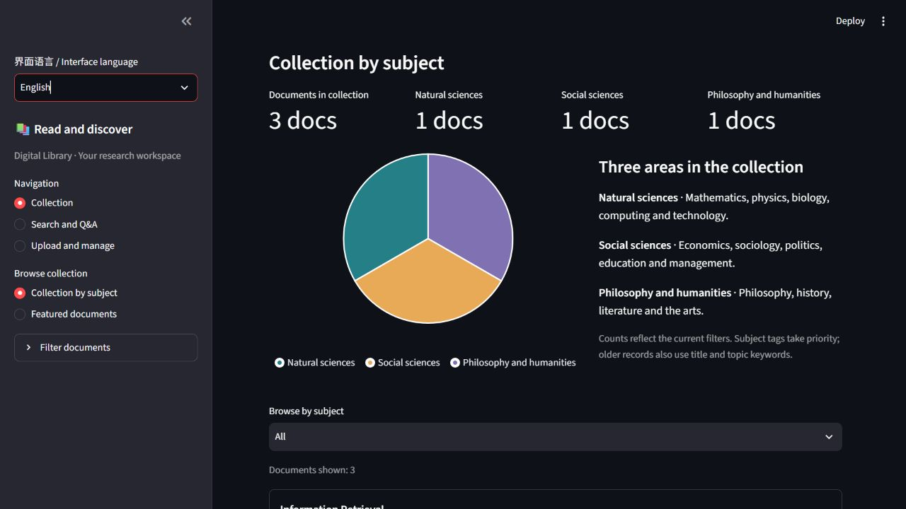

# PR10 与 PR11 合并前验收

2026-10-20，用户授权检查两项PR，达到标准后按PR10→PR11顺序合并。本轮验收通过，无阻断项。PR10已通过普通merge合入main；PR11保留其独立缺陷修复范围，按同一验收结果继续合并。

## 验收结论

PR10仅新增语言入口与显示翻译，保留原STYLE、163个原有界面调用、布局、默认值，以及搜索、澄清和上传三个表单。题名、作者、正文、回答、学科存储值和服务配置不变。使用手册的原生成器未改，源文件与Word哈希和11页渲染记录一致。

PR11仅将固定饼图半径改为随有效绘图区宽高计算，保留主题、布局、配色、图例、图表高度与计数。组合版本保留PR10全部界面翻译，同时修复中文和英文模式的圆周裁切。

| 验证 | 干净源码提交 | 结果 |
| --- | --- | --- |
| PR10专项与全量 | `93dc297374a9718523795f3f5a6c1520aae9b8fb` | 26项 / 623项通过 |
| 组合版本UI-002专项 | `1973b4135c90877ab90b15e55d21d56e21d9674f` | 26项通过 |
| 组合版本UI-003专项 | 同上 | 9项通过 |
| 组合版本全量 | 同上 | 632项通过：原main597项、UI-002新增26项、UI-003新增9项 |

均无失败、错误或跳过。仅保留既有TestClient弃用及重复文件提示。PR11的新增用例仍计为9项，PR10的26项作为继承回归，不重复计入PR11贡献。

## 组合与冲突处理

两项PR均起于main `7d9abaf`。PR10增加独立验收记录后头为 `ad131b8`；与PR11原头 `6835e52` 组合时，重叠出现在AGENTS.md、饼图参数行和测试分组注册处。

应用文件以PR10为准，仅替换PR11的outerRadius属性；测试运行器同时保留UI-002、UI-003分组；任务说明保留双方历史记录和本轮新授权。没有改造布局或表单。合并候选提交1973b41通过上述全部测试。

PR10随后实际合并为 `d43d075ba19d705506fce1743c16eaac77b66410`，已核对完整文件树与两个父提交。再将该main提交通过普通merge纳入PR11候选历史，应用文件树、测试文件及运行器与测试版本完全一致。之后只增加验收记录，不修改源码。

- [验收与源码绑定](acceptance.json)
- [冲突处理范围](conflict-resolution.json)
- [PR10实际合并回执](pr10-merge.json)
- [PR10独立复验](../UI-002/acceptance-20261020/acceptance.json)
- [组合UI-002专项](combined-ui002/summary.json)、[组合UI-003专项](combined-ui003/summary.json)、[组合全量](combined-full/summary.json)

## 浏览器和环境

独立验收目录绑定本轮源码，使用新的三篇合成PDF、数据存储和19060/19660端口，MOCK模式不调用模型。实际检查中文和英文饼图、语言切换、英文搜索提交、问答与引用原文页，以及原有英文上传表单。两种语言下，包含描边的扇区都位于SVG内。

完整记录见[浏览器检查](browser.json)。18000、19000、19010、19020、19032、19040、19050七个原实例快照前后一致，验收库仍为三篇，见[存储核对](storage.json)。未部署、迁移馆藏或重启原有服务。

历史测试产物与手册哈希已复核，原失败证据没有改写，见[历史记录核对](history-verification.json)。GitHub当时没有配置托管检查，也没有待处理的拒绝评审，见[验收前状态](prs-before.json)。本轮依据新运行的测试与浏览器结果验收；发布文件检查见[发布检查](publish-audit.json)。
