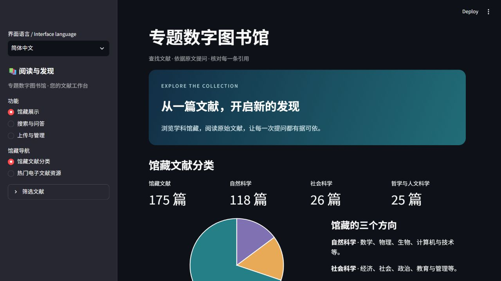
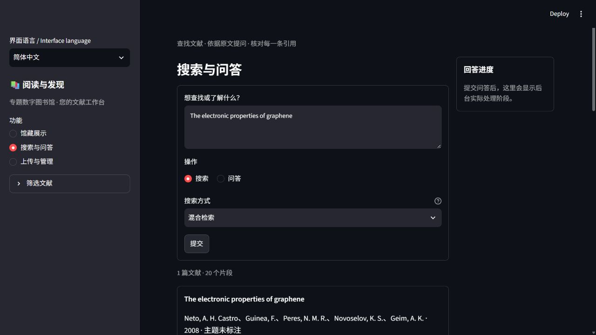

# COL-005：100篇自然科学文献正式入库

本批新增100篇，正式馆藏由75篇增至175篇。涵盖12个方向，包括基础理论、实验证据、天文观测、临床试验、资源测绘与常用研究方法。完整目录见[catalogue.md](catalogue.md)，每篇的来源、版本年份、完整署名或论文明确的合作组署名、文件哈希及手动补正见[curation-review.json](curation-review.json)。

## 学科覆盖

| 研究方向 | 新增篇数 |
| --- | ---: |
| 数学统计 | 10 |
| 基础物理 | 10 |
| 天文宇宙 | 8 |
| 化学材料 | 10 |
| 地球科学 | 10 |
| 环境气候 | 8 |
| 生态进化 | 8 |
| 分子遗传 | 10 |
| 医学公共健康 | 8 |
| 神经科学 | 6 |
| 农业植物食品 | 6 |
| 工程能源 | 6 |

这些文献以研究内容的代表性和方向互补为选取依据，并非按单一引用量排出的“全球前100”。例如包含Ricci流、Shor算法、希格斯粒子发现、引力波、黑洞成像、石墨烯、点击化学、全球碳预算、DNA结构、CRISPR、AlphaFold、SPRINT、Hodgkin–Huxley模型、作物基因组及钙钛矿太阳能电池。

## 实际入库结果

- 新增100份完整PDF、2758个物理页、11555个正文片段；最终175篇/16699片段均ready。
- 100份文件哈希、元数据、物理页数、片段数及全部页内引用偏移一致；SQLite完整性为ok。与旧库无内容、题名或来源DOI重复。
- 100个题名分别使用keyword/vector/hybrid、top5验证，命中300/300。这是入库可用性核对，不是300个新算法用例或语义理解正确率。
- 原75篇的元数据、页面、片段及PDF字节保持，8个其他馆藏实例完整快照保持。已有旧资料分类状态未在本批改写；本批100篇均有自然科学标签。

使用已部署主分支`8174362c38fcd62b722b5133692c7e9662355b87`。先在正式库一致副本中调用现行`LibraryStore.ingest_pdf`解析100份文件，再统一调用一次`Services.rebuild`，使用真实本机BGE FP16重建索引。没有复制其他测试库的正文记录，也未虚构100次界面点击或HTTP任务。副本通过核对后，切换原正式入口；原库和备份保留。程序源码、接口和提示词未修改。

## 识别问题与临时处置

见[observations.md](observations.md)。增强识别完成仍存在标题续行误作作者、长作者名单缺项、20篇学科留空等问题；43篇年份候选为空，另有存档年份混淆。助手按所收录原文及一手书目临时补正，未把这些问题标成已修复。合作组论文按原文明确的合作组署名编目，不把这类正常署名算成作者遗漏。

9份原候选被当前正文门槛正确要求审核，另1份更换版本后处理；共10份、121页外部OCR。原件、高分辨率工作稿及处理回执均保留；两个大文件另制140dpi阅读副本并核对压缩前后文字相同。抽样核对了处理页的版面与正文，不声称逐一校准所有数学公式。来自外部链接的同题名SPRINT来函已隔离，最终收录的是UAB保存的14页原始研究。

`system-previews/`保留100篇当前原始候选元数据和诊断，替换版本及错误来函另见selected-alternate-versions.json。私有原始输出包含完整摘录，仓库版仅隐去正文长摘录与本机路径，未改写候选字段。下载失败、编号校正和换选记录与产品缺陷分开保留。PDF、数据库、凭证、本机服务接线均未加入Git。

## 核查入口

入库计划：plan.json；逐篇核对：preflight.json与curation-review.json；实际事件：events.jsonl；正式回执：receipt.json；源码与保护快照核对：verification-summary.json。界面核对见ui-verification.json及下图。

检索截图也保留了本次发现的COL005-U01：汇总卡片显示“主题未标注”。对照实际接口，hits[].chunk.document包含正确topics，而documents[]汇总对象漏带该字段；馆藏分类页与存储记录均正确。本次只登记，未改界面或程序。

本PR只归档本批选文、临时处置与入库证据，保持Draft，暂不合并。
