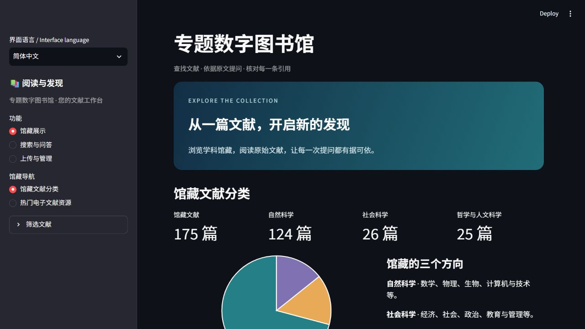

# COL-006 六篇待分类旧文献重新入库

用户于2026-10-20要求移除正式馆藏中残留的六篇待分类文献，再按当前流程重新入库。执行前175篇、6篇待分类；执行后仍175篇、0篇待分类。六篇均由当前增强识别自动分类为自然科学，总分布为自然科学124篇、社会科学26篇、哲学与人文科学25篇。

## 实际流程

先保存原 PDF、旧记录、SQLite 备份和有效索引。在正式库的一致副本中删除六条记录及级联页面、片段和主题，并移出副本中的旧原文；通过文献接口确认六条均返回404。随后对同一批原 PDF 重新增强识别，核对标题、75位有序作者和所收录 PDF 的版本年份。具体主题词与权利说明经助手核对后沿用，不是直接更新旧记录来增加学科。

六篇经正常 POST /documents/jobs 异步上传接口重新登记、解析并建索引，记录了六个不同的入库任务ID。每篇新created_at均与旧备份不同，当前解析器为pymupdf-conservative-v4。文件内容未变，因此文献ID按SHA256规则保持相同；这不等于复用旧编目记录。六篇合计100页、564个正文片段，全文提取和片段偏移均已核对。

| 文献 | 核对作者数 | PDF版本年份 | 自动分类 |
| --- | ---: | ---: | --- |
| ENEC | 20 | 2026 | 自然科学 |
| Squeezing Operator Performance Potential for the Ascend Architecture | 18 | 2025 | 自然科学 |
| Is Your NPU Ready for LLMs? | 7 | 2026 | 自然科学 |
| CSB-RNN | 9 | 2020 | 自然科学 |
| XY-Serve | 12 | 2026 | 自然科学 |
| SpinQuant | 9 | 2025 | 自然科学 |

Ascend 首轮增强识别只保留一位作者；重新识别后完整返回18位，出版资料补全实际为not_needed。首次结果、重识别结果和助手核对分别记录，没有改写失败或声称产品已修复。详见[观察记录](observations.md)。

## 验证结果

在独立副本中，六篇各用关键词、语义和混合检索，18次题名查询均在前5项命中；原文下载哈希、全部目标正文偏移、新旧创建时间及解析版本通过核对。完成后切换原正式入口，再执行18次题名查询及六次原文下载校验，全部通过。正式馆藏仍为175篇、16,699片段，待分类为0。

其余169篇的四张表记录、元数据、正文和原文保持一致；全部175份原文内容哈希保持；八个既有馆藏实例也保持不变。原始馆藏目录和备份继续保存。验证归属是本次真实流程检查，没有新增产品修复或单元测试，也未把历史全量回归算作本轮执行。

应用源码仍为main 446f7b5。本项独立工作目录执行提交为f19f94b，应用树与正式部署相同；只追加COL-006工作说明和结果。本机模型接入、密钥、PDF、正文、数据库与索引保存在仓库外，未成为交付依赖。PR13–PR15继续按用户决定保留为测试记录，本项另建Draft PR。

## 追溯材料

- [删除及级联数量](deletion.json)、[接口404证明](absent-api.json)、[旧记录时间与解析器](old-record-proof.json)
- [首次增强识别任务及重识别](metadata-jobs.json)、[已核对的入库计划](plan.json)、[助手PDF核对](agent-review.json)
- [六个正常上传任务](imports.json)、[独立副本验证](candidate-verification.json)、[正式入口验证](formal-checks.json)
- [最终回执](receipt.json)、[其他馆藏保护核对](protected-catalogues.json)、[执行归属与耗时](execution.json)
- [事件链](events.jsonl)、[发布检查](publish-audit.json)、[原始材料哈希](evidence-hashes.json)

事件链用于追溯记录和检测修改，不是人工签名。JSON/JSONL公开摘录统一序列化为LF，摘录中保留的字段值、任务ID和事件链值不改写；本机存储路径及接线信息省略，原件及原件哈希另外保存。

