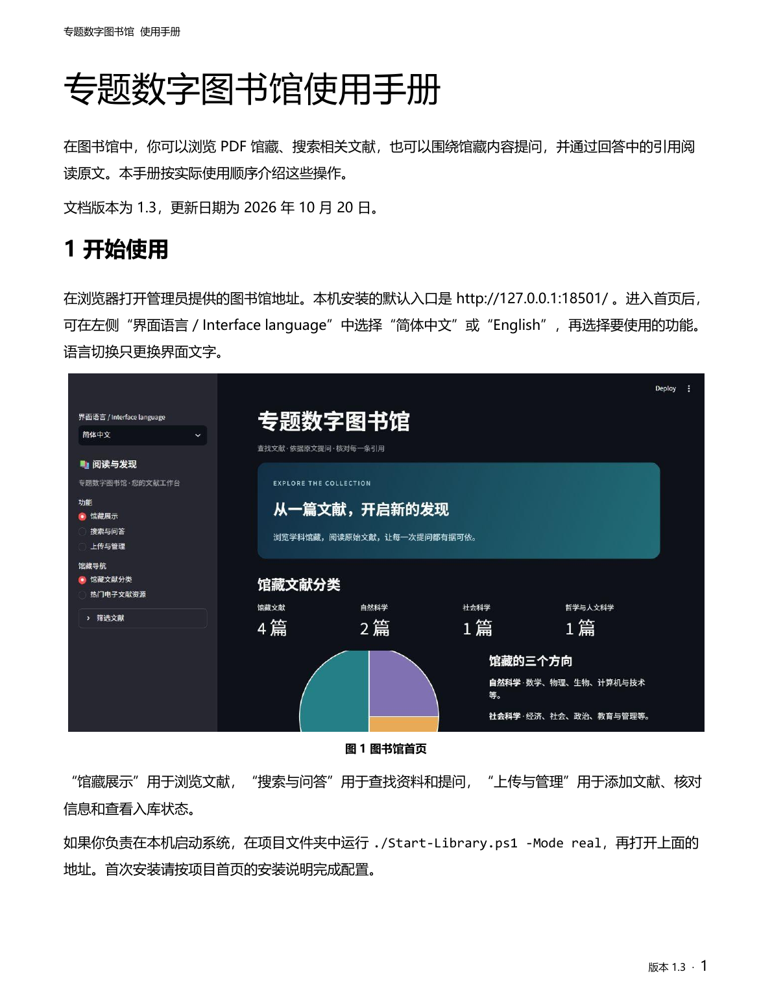

# DOC-002 使用手册中文字体修复

用户于2026-10-20指出MS Gothic的中文渲染问题，要求使用常见中文字体。本次将Word和PDF统一为微软雅黑，保留命令示例中的Consolas。

## 原因与修改

原Word的部分样式虽已写入Microsoft YaHei，但同时保留了asciiTheme、eastAsiaTheme等主题引用，主题的东亚语言仍为ja-JP。模板中还带有MS Gothic、MS Mincho日文字体，旧PDF实际嵌入MS-Gothic，标题出现字体混用。

修复清除主题对字体的覆盖，将东亚语言设为zh-CN，在正文、标题、表格、图注、页眉页脚和字段结果中明确指定微软雅黑；主题的中日文字体回退也统一为微软雅黑，字体表移除日文字体条目。生成脚本在保存前执行同样处理。

现有手册采用原文件就地修改字体，没有重写正文、图片、字号、边距或章节。版本仍为1.3，作为该版的字体修订。应用、界面和馆藏不变。

## 验证

- DOCX所有文本和内嵌图片与修复前完全一致；无MS Gothic或MS Mincho引用，无主题字体覆盖。
- 新生成器重新构建后仍使用微软雅黑；重复应用字体修复不改变OOXML内容。
- Word经WPS导出PDF，再用打包的render_docx.py以140 DPI渲染。11页均逐页检查，未发现新增截断、重叠、空白页或缺字。
- PDF实际字体仅有MicrosoftYaHei、MicrosoftYaHei-Bold及Consolas，均已嵌入，不含MS-Gothic。

详见[Word检查](docx-check.json)、[PDF检查](pdf-check.json)和[验证与文件哈希](verification.json)。生成的PDF与Word阅读版保存在本机交付目录；PDF未混入馆藏或测试语料。发布检查见[publish-audit.json](publish-audit.json)。

本项独立PR，暂不合并。原UI-002、UI-003及验收记录保留历史文件哈希，不回写旧证据。
