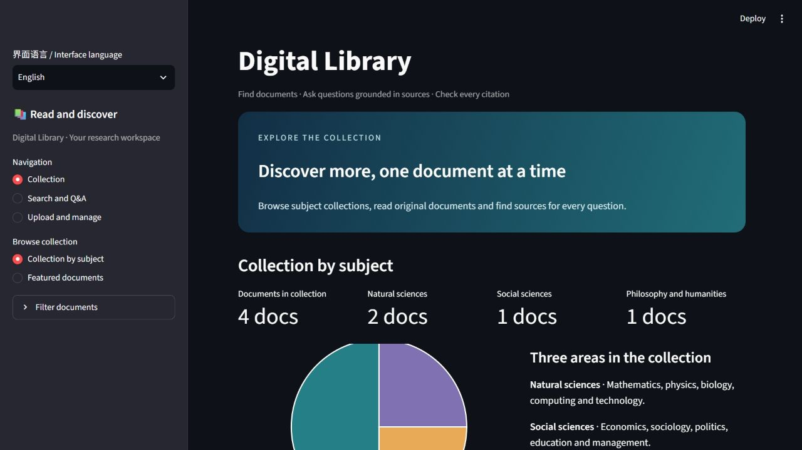

# UI-002 中英文显示切换 R2 验证

2026-10-20，按用户要求撤回首版界面改动，继续在 PR10 添加语言入口与显示文本翻译，暂不合并。

首版的 dev 启动指定了浅色主题和配色，并移除了原来的表单边框与提交结构。`cd7ab93` 用普通 revert 完整撤回首版，其文件树等于 main `7d9abaf`；首版内容和验证仍可在历史提交 [`c0f0c18`](https://github.com/Dan1un1u/digital-library-rag/tree/c0f0c18d8aa36e2bfe5cc010ac6826fb2d0c70d6) 查阅。R2 恢复默认主题启动，保留原样式、布局、导航顺序、默认值，以及搜索、澄清和上传三个表单。

## 本次改动

侧栏增加“界面语言 / Interface language”，可选择简体中文或 English。翻译按钮、导航、说明、状态、错误提示和引用原文页的界面文字。题名、作者、原文、回答和保存的学科值保持原内容；服务配置与模型调用不变。

中文首页：

英文首页：

## 自动验证

正式测试绑定干净提交 `1447f2a8b0446f25f40f7c71726c8dc0e8d99efd`，随后仅更新文档、配图和记录。

| 验证 | 结果 | 记录 |
| --- | --- | --- |
| 本项新增用例 | 26 项通过 | [目标测试](R2/target/summary.json) |
| 全量回归 | 623 项通过，含本项 26 项、继承 597 项 | [全量测试](R2/full/summary.json) |
| 原界面结构 | 163 个原有 Streamlit 调用、列布局参数、三个表单及提交按钮顺序相同 | [结构核对](R2/structure.json) |
| 原样式 | STYLE 哈希与 main 相同，无主题启动覆盖 | [结构核对](R2/structure.json) |

目标用例覆盖两种语言、六个导航页面、语言切换与已提交检索/回答、引用链接、原文显示、错误提示和入库时的标准学科值。原始 pytest、JUnit、覆盖率文件及其哈希随 summary 一起保留。测试有既有 TestClient 弃用提示，全量另有两项重复文件提示，无失败或跳过。

## 浏览器与馆藏验证

R2 使用独立数据目录 `runtime/UI-002-R2/dev-library`，API 为 19040，界面为 19640；历史首版数据目录不复用。以 MOCK 服务和合成 PDF 验证界面流程，不调用模型服务。

实际浏览器完成中文首页、英文切换、表单搜索、PDF 选择与识别预填、填写原上传表单并提交、英文管理状态、切回中文和系统设置检查。独立库从三篇合成文献增至四篇，新文献为 `Neural Information Retrieval`，状态可阅读，学科仍保存为“自然科学”。详见[浏览器记录](R2/browser.json)。

18000、19000、19010、19020、19032 的五个已有馆藏实例在测试前后快照一致，见[馆藏核对](R2/protected-libraries.json)。

## 使用手册

恢复原有章节、排版和生成器，只更新版本日期、开始使用中的语言选择说明及首页配图。Word 仍为 11 页，使用打包的渲染器配合 WPS 导出逐页检查，未发现新增溢出、截断或空白页。见[手册记录](R2/manual.json)。

[源码绑定](R2/source-binding.json)记录测试版本、app 文件树及完整回退依据；[发布检查](R2/publish-audit.json)记录待发布文件检查结果。PR10 保持 Draft。
