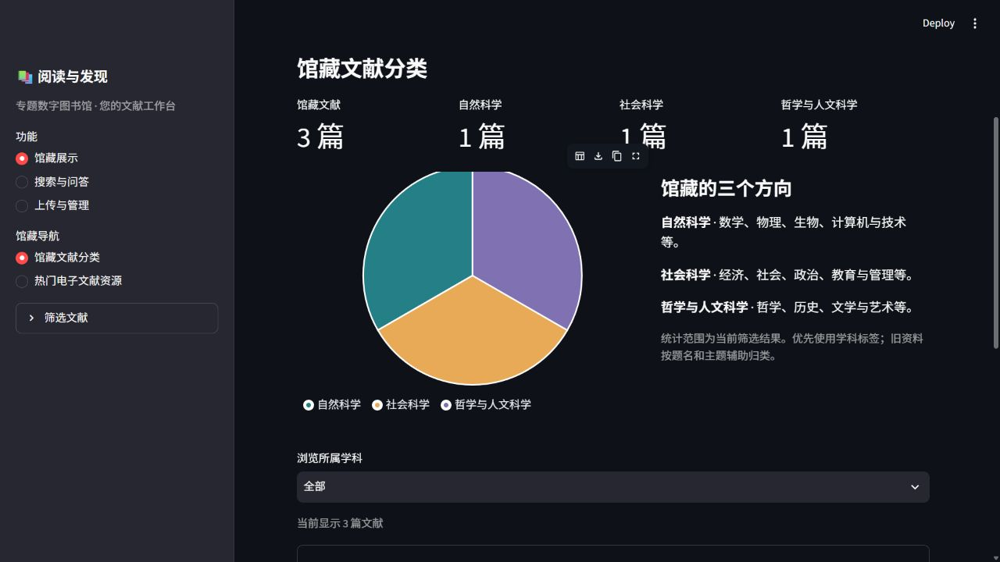
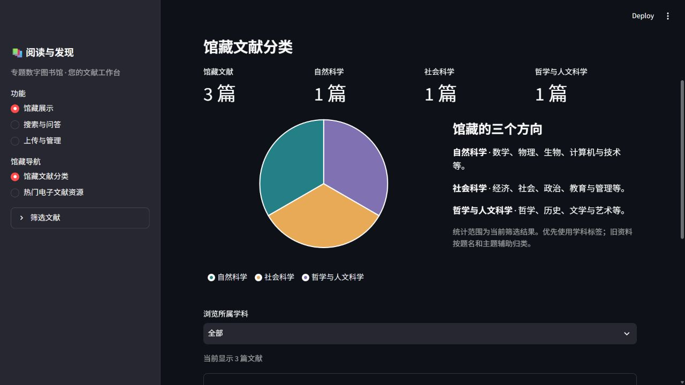

# UI-003 学科分类饼图顶部裁切

2026-10-20，按用户反馈检查原始项目。结论：原始交付版本已有此问题。修复仅调整饼图的一个半径参数，独立PR以main为base，暂不合并；PR10不变。

## 复现与原因

原始交付源码、首次导入提交 `65f168f`、main `7d9abaf` 的整段饼图配置AST一致，均设置固定半径140、图表高度340和底部图例，见[源码绑定](source-binding.json)。此外，在旧界面18501和使用原始交付UI的独立dev19650均可复现。

图表布局会为图例、边距等分配空间，实际绘图区小于外层图表。固定半径不随绘图区收缩，圆弧因此伸出SVG并被裁切，看起来像被上面的UI盖住。在独立dev的1280×720浏览器中，顶部几何边界越界7px；计入2px描边后越界8px。

修复前：

半径改为 `max(0, min(140, width / 2 - 1, height / 2 - 1))`，根据实际绘图区宽高留出1px描边余量，并保留最大半径140。图表库允许使用表达式指定半径，参见[Vega-Lite Arc属性](https://vega.github.io/vega-lite/docs/arc.html)。页面布局、主题、颜色、340px图表高度、图例、计数和交互不变。

修复后，包含描边的圆周完整落在SVG内，顶部余量约3px：

## 测试与结果

| 阶段 | 干净源码提交 | 结果 |
| --- | --- | --- |
| main代码加缺陷测试，修复前 | `23996176afdc070598cb195e1d3d022327cf05d7` | 4项失败、5项通过，失败均为半径越界 |
| 修复后目标测试 | `0f15f2883dbe44b9354c870d425548dc07d2f92e` | 9项通过 |
| 修复后全量回归 | 同上 | 606项通过：本项9项、继承597项 |

五组绘图区宽高测试检查圆周与描边都能容纳；三组分布测试覆盖均衡、单学科、偏斜分布，并核对原计数、配色、图例和导航；另一项检查空馆藏提示。该PR直接基于main，因此不包含PR10的26项语言测试。

原始运行输出、JUnit、覆盖率和哈希分别保存在[修复前](red/summary.json)、[目标测试](target/summary.json)和[全量回归](full/summary.json)。全量仅有既有TestClient弃用和重复文件提示，无失败、错误或跳过。提交后的改动只增加文档、配图与验证记录。

## 浏览器与环境

独立库包含三篇合成PDF，分别为三个学科，年份2023、2024、2025。API19050，原始交付UI19650，修复UI19651，均使用默认主题启动。浏览器实际检查三学科饼图、筛选2025后的单学科圆形，以及筛选2099后的空结果提示；扇区、描边和图例在所测SVG内。不同绘图区宽高另由算法测试覆盖。

- [浏览器边界数据与截图哈希](browser.json)
- [单学科截图](screenshots/after-single.png)
- [空结果截图](screenshots/after-empty.png)
- [馆藏快照核对](storage.json)：18000、19000、19010、19020、19032、19040六个已有实例前后一致；本项dev库仍为三篇。
- [发布检查](publish-audit.json)：运行环境、PDF语料和本机凭证不入库。

生产代码相对main只有一行参数变化，原样式文件没有修改。[工作项](../../work-items/UI-003.md)记录缺陷与PR隔离范围。
